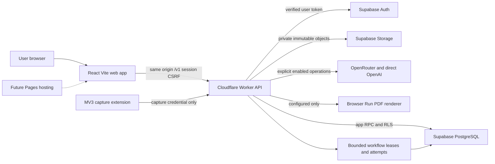

# Resumora Codex Desktop project handover

Documentation snapshot: **30 October 2026, 18:17–18:54 UTC**. Git/runtime/forge observations began at 18:17 UTC; local HTTP and installed-tool checks were made during this handover. This is an uncommitted documentation deliverable, not a release, migration approval or instruction to resume frozen implementation.

**Publication note:** This document records the local snapshot above. Its references to an uncommitted draft and no commit/push describe that original preparation stage. The subsequently authorized GitHub publication contains only this Markdown; it does not publish or integrate local source13 application code. Absolute Linux links remain nonportable local references.

**Start here:** the integrated app runs from **source13**, branch `fm/resumora-job-extension`, commit **315d8f6b657aa4341b92133662d03bcdcdc61d5e**, at **http://127.0.0.1:15173**. The requested primary repository is an older `main` checkout. Do not implement in it assuming it contains the running app. Photo upload still fails for the owner; the latest code adds safe diagnostics, not a proven root-cause fix. See [safe environment selection](#2-local-environment), [Git custody](#3-git-and-github), and [the recommended first task](#recommended-first-task-for-codex).

## Evidence legend

| Label | Meaning in this document |
| --- | --- |
| Verified code | Read from integrated source13 at `315d8f6`, unless another SHA is named. Implementation existence does not establish live success. |
| Verified local runtime | Read-only service/path/HTTP observations during this handover. Public app returned 200 with build banner `315d8f6`; proxied health returned 200. No authenticated owner flow was run. |
| Verified hosted service | A dated private operator receipt establishes the stated hosted event. This handover made no authenticated hosted-service calls. |
| Synthetic-only | Executable tests or browser/native-PG receipts use synthetic identities, documents or injected providers. They do not establish model quality or owner acceptance. |
| Inferred | A supported interpretation, explicitly identified; not an observed event. |
| Planned | Product/research proposal or deferred implementation, not existing functionality or new authorization. |
| Unknown | Missing or insufficient evidence. Unknown cost, outcome, compatibility or deployment must not be reported as zero, success or failure. |

**Path convention:** code paths in backticks are relative to the integrated source13 root below. Links to `/home/cosmin/...` are local and nonportable. The document entry point is the requested primary root; its draft was authored in an older isolated copy. Source references describe source13, not whatever code happens to surround the published document.

## Contents

1. [Project overview and product vision](#1-project-overview-and-product-vision)
2. [Local environment](#2-local-environment)
3. [Git and GitHub](#3-git-and-github)
4. [Architecture](#4-architecture)
5. [Practical directory and file map](#5-practical-directory-and-file-map)
6. [API reference](#6-api-reference)
7. [Configuration and secrets matrix](#7-configuration-and-secrets-matrix)
8. [Database and authentication](#8-database-and-authentication)
9. [Feature status inventory](#9-feature-status-inventory)
10. [History and decisions](#10-history-and-decisions)
11. [Known bugs debt and risks](#11-known-bugs-debt-and-risks)
12. [Tests and QA](#12-tests-and-qa)
13. [Deployment and infrastructure](#13-deployment-and-infrastructure)
14. [Agent work and pending tasks](#14-agent-work-and-pending-tasks)
15. [Prioritized roadmap](#15-prioritized-roadmap)
16. [Handover verification and limits](#16-handover-verification-and-limits)
17. [Recommended First Task for Codex](#recommended-first-task-for-codex)

## 1 Project overview and product vision

Resumora is a Romanian-first, English-secondary CV editor and vacancy workflow. Its intended users maintain a reusable Base career record, review extracted source evidence, add missing context, compare that evidence with an explicitly reviewed vacancy, approve tailored wording, and retain an independently editable current CV for each job and language.

The practical goal is trustworthy career content and clear control over proposed changes. Imported text is not automatically a user attestation; generated prose is not new factual evidence. Source provenance, explicit confirmation and separate presentation protect against invented experience, credentials, dates and achievements. A high evidence-coverage indicator does not imply work authorization, professional recognition or an employer's decision.

The integrated code contains account/session handling, Base persistence/history, guided import review, career questions/rewrite, five shared templates, current job CVs, job processing/matching/tailoring, reviewed RO/EN translation and guarded export integration. Verification differs by feature; consult [the inventory](#9-feature-status-inventory). AI is enabled in the current private local runtime for the owner's manual actions; checked-in defaults remain OFF.

Important product policies established by the current implementation:

- Base CV has snapshots/history, career answers and original-source context. Remove Base removes those across Base language copies, while preserving independent current tailored CVs.
- Tailored CVs have **one current document per job and language**. RO and EN coexist. Old tailored revision/history/restore access is retired; internal CAS counters do not imply user-visible history.
- Hiding a field, contribution group or section affects presentation. It must preserve saved content. Base removal separately sanitizes deleted Base context from retained job documents.
- Vacancy extraction must be explicitly reviewed and saved before matching/tailoring. Optional clarification answers remain optional.
- Profile Evidence Coverage and CV Evidence Coverage are explainable application indicators. Eligibility is separate from weighted skill coverage. These are not proprietary external ATS scores, hiring probabilities or empirically calibrated universal ATS guarantees.

Business direction is partly recorded, not operationalized: subscriptions/credit packs and rollover are proposed/accepted planning inputs, while Stripe and commercial enforcement remain deferred. Money prices, refund/cancellation details, launch cohort, retention/legal policies and validated business metrics are not settled by this code. Application tracking and broader account-management journeys exist in discovery/schema, not as a complete launched product.

Read [product requirements](/home/cosmin/.treehouse/AI-CV-Maker-V2-180668/13/AI-CV-Maker-V2/docs/product/prd.md), [customer journeys](/home/cosmin/.treehouse/AI-CV-Maker-V2-180668/13/AI-CV-Maker-V2/docs/product/customer-journeys.md), and [current job workflow](/home/cosmin/.treehouse/AI-CV-Maker-V2-180668/13/AI-CV-Maker-V2/docs/setup/job-workflow.md). The first two retain discovery-era status/version assumptions, including job history; the current-only implementation and later operator receipts supersede those specific statements.

## 2 Local environment

### Choose the correct copy before editing

| Copy | Verified absolute Linux path | Purpose and safe treatment |
| --- | --- | --- |
| Primary requested repository | `/home/cosmin/firstmate/projects/AI-CV-Maker-V2` | Older `main`; preserve modified `.gitignore` and untracked `treehouse.toml`. Requested entry point for this document. |
| Integrated running source13 | `/home/cosmin/.treehouse/AI-CV-Maker-V2-180668/13/AI-CV-Maker-V2` | Current app code, clean `315d8f6`. Existing services watch it; editing API code may cause reload during paid work. |
| This handover draft copy | `/home/cosmin/.treehouse/AI-CV-Maker-V2-27c120/1/AI-CV-Maker-V2` | Older clean admin branch before this Markdown. Not the running app and not a source-update target. |
| Photo/upload source3 | `/home/cosmin/.treehouse/AI-CV-Maker-V2-180668/3/AI-CV-Maker-V2` | Frozen photo/download author; its existing private `.dev.vars` is a current runtime input. Do not move/delete/copy it. |
| Import/name source18 | `/home/cosmin/.treehouse/AI-CV-Maker-V2-180668/18/AI-CV-Maker-V2` | Frozen import/name author; changes integrated into source13. |
| Preserved source16/source17 | `/home/cosmin/.treehouse/AI-CV-Maker-V2-180668/{16,17}/AI-CV-Maker-V2` | Rollback/old serving copies. Do not start them: old AI configuration differs and compatibility with upgraded schema is unverified. |

These are linked worktrees sharing the primary Git repository. Source13's `.git` contains a Linux `gitdir` path under the primary `.git/worktrees/AI-CV-Maker-V216`. The primary location and live source location are deliberately distinct. Do not reset, clean, rebase, switch branches, relocate or recreate worktrees as an onboarding step.

Read-only first commands, using Linux Git inside WSL:

```sh
pwd -P
git -C /home/cosmin/.treehouse/AI-CV-Maker-V2-180668/13/AI-CV-Maker-V2 rev-parse --show-toplevel HEAD
git -C /home/cosmin/.treehouse/AI-CV-Maker-V2-180668/13/AI-CV-Maker-V2 status --short --branch
```

### Windows and WSL facts

Verified host environment: Ubuntu 24.04.2 LTS, Linux `6.6.87.2-microsoft-standard-WSL2`; `wsl.exe --list --verbose` reports running default distro **Ubuntu**, version **2**. `/etc/wsl.conf` enables systemd and default user `cosmin`. WSL interface address observed `172.19.187.2` is ephemeral; the app binds loopback, not that address. Windows-to-app connectivity was not retested in the owner's browser during this handover.

Windows PowerShell `Test-Path` verified both UNC directories:

```text
\\wsl.localhost\Ubuntu\home\cosmin\firstmate\projects\AI-CV-Maker-V2
\\wsl.localhost\Ubuntu\home\cosmin\.treehouse\AI-CV-Maker-V2-180668\13\AI-CV-Maker-V2
```

Installed Windows Appx metadata reports `OpenAI.Codex` version `26.1021.3705.0` at `C:\Program Files\WindowsApps\OpenAI.Codex_26.1021.3705.0_x64__2p2nqsd0c76g0`, and `OpenAI.ChatGPT-Desktop` version `1.2026.190.0`. These are application install directories, not project clones. No native `C:` project copy was established or created.

Official OpenAI guidance checked 30 October 2026: add a WSL project through **Add new project / Ctrl+O**, enter `\\wsl$\`, then choose Ubuntu and the folder. The Windows app defaults to a native agent; selecting a WSL agent in Settings requires an app restart. Terminal selection is independent. For this existing Linux worktree, prefer WSL execution and verify Linux Git resolves its absolute gitdir before any write. Windows-native Git resolution of this UNC linked worktree and actual Desktop opening were **not tested**. Official docs identify Windows-native WSL filesystem reliability limits. Do not move the project or synchronize credential/config homes implicitly. [Official Windows app and WSL guidance](https://learn.chatgpt.com/docs/windows/windows-app), [Windows sandbox](https://learn.chatgpt.com/docs/windows/windows-sandbox).

### Inherited instructions are a transition boundary

The primary repository has **no project-local `AGENTS.md` or `CLAUDE.md`**, but sits beneath `/home/cosmin/firstmate/AGENTS.md` and its `CLAUDE.md` import. Those define Firstmate supervisor behavior, including orchestration constraints. A fresh Codex project session under that parent can inherit them. Do not copy that supervisor identity into project instructions or assume this handover overrides inherited instructions.

Source13 is outside `/home/cosmin/firstmate/`; ancestor checks found only `/home/cosmin/CLAUDE.md`, a generic historical home-directory note, and no project/nested AGENTS/CLAUDE files. Git's common repository path does not change the filesystem ancestry. Confirm the new Desktop session's actual instructions and working directory before action. If inherited instructions prevent ordinary project work, obtain explicit user direction for the transition; historical Firstmate orchestration is evidence, not a required supervisor for future Codex development. A standalone clone/relocation is a possible future user-directed migration, not an action authorized here.

### Installed and declared toolchain

| Tool | Observed installed | Source constraint |
| --- | --- | --- |
| Node / npm | `v22.23.4` / `10.9.9` | `.nvmrc`, Node `>=22.13.0 <23`, npm `>=10 <11`; `packageManager: npm@10.9.9` |
| Git / Python | `2.43.0` / `3.12.3` | Python standard library/native PostgreSQL test harness |
| Codex CLI | `0.166.0`, `/home/cosmin/.nvm/versions/node/v22.23.4/bin/codex` | Separate from Windows Desktop version/config |
| React / Vite / TypeScript / Vitest | `19.3.1` / `8.3.5` / `7.0.2` / `5.0.5` | Source13 package and installed package metadata agree |
| Wrangler / Auth SDK / Puppeteer | `4.152.0` / `@supabase/auth-js 2.118.0` / `@cloudflare/puppeteer 1.4.0` | Exact workspace versions, root lockfile |
| Native PostgreSQL | Relocated PG17 tooling available under `/home/cosmin/firstmate/data/resumora-db-connect/tooling/pg17/usr/` | Existing receipts use PG17; CI declares PG16. No database started here. |

This documentation worker's metadata verifies `gpt-6.1-sol`, effort `high`. That is an authoring-agent setting, not the app's inference model. The [official model page](https://developers.openai.com/api/docs/models/gpt-6.1-sol) supports high reasoning; no model setting was changed.

### Existing runtime and normal development commands

Active user services verified by `systemctl --user show`:

- `resumora-final-test-web.service`: source13 `apps/web`, port **15173**, private wrapper `data/resumora-job-extension/local-test/vite.final-test.config.mjs`.
- `resumora-final-connected-ai-api.service`: source13 `apps/api`, local Wrangler port **18787**, inspector port **19347** in its existing launch definition.

The wrapper proxies `/v1` to `http://127.0.0.1:18787` with `changeOrigin:false`, imports source13 Vite config and adds a local build banner. Browser-facing APP_ORIGIN and API_ORIGIN use the same **15173** origin, not the internal Worker port. Keep `127.0.0.1`; `localhost` changes origin/cookie behavior. The wrapper's historical plugin name contains “synthetic”; its current entry is the real `src/main.tsx` with saved-data transport. `/synthetic` is not proof of mocked data.

Normal clean-checkout commands from `package.json` and the local guide, for a separately coordinated non-serving checkout only:

```sh
npm ci --ignore-scripts
npm run dev
# Or separate terminals:
npm run dev:web
npm run dev:api
```

Defaults are web 5173 and API 8787; `scripts/dev.mjs` starts/stops only its own pair via `scripts/dev-processes.mjs`. Do not run these to replace the existing 15173/18787 services, install over their dependencies, or stop another preview. Build/check commands are in [Tests and QA](#12-tests-and-qa). No installation, start, stop or restart occurred during this handover.

## 3 Git and GitHub

The configured origin literal remains **`https://github.com/Cosmiin/AI-CV-Maker-V2.git`** for fetch and push. Read-only forge lookup resolves it to the private canonical repository **[Cosmiin/Resumora](https://github.com/Cosmiin/Resumora)**, default branch `main`. Do not normalize/remap the remote. Local `no-mistakes` and `no-mistakes-default-preserved` remotes point to private tool-managed repositories; leave them alone.

| Checkout/ref | Observed head | State |
| --- | --- | --- |
| Primary `main` | `ad1325a4276e1a9d1651bfb146a21b2ce3625924` | Behind local `origin/main` by 23; `.gitignore` modified, `treehouse.toml` untracked. Preserve both. |
| Local `origin/main` and fresh GitHub `main` | `e1285b2a757e9b0f0255c977c3de330a5bb78c89` | Latest merged enrichment baseline; neither is source13's integrated head. No fetch performed. |
| Source13 `fm/resumora-job-extension` | `315d8f6b657aa4341b92133662d03bcdcdc61d5e` | Clean; integrated local running code. Not found by GitHub's commit-check lookup; no published branch of this name appeared in the branch listing. |
| Source3 `fm/resumora-download-languages` | `b5656234fac3f00b69b579c0d7c213dedb62aded` | Clean; latest photo diagnostics integrated by `315d8f6`. |
| Source18 `fm/resumora-import-review-ux` | `26fffbc2c2673f1acfe930375b21e5cdb95c74db` | Clean; imported-name fix integrated via `ec74239e3b6985bc275f2615dbbcf9b37e026709`. |
| Source17 `fm/resumora-enrichment-ux` | `9c7cde6e3f2430ce69e6dbcf4922062007850745` | Clean, preserved former serving code; not active source13. |
| Source16 detached | `0ae61641ad807c95b2ffe5846af5838d0d827dfe` | Clean preserved rollback/scout copy. |
| Handover/admin branch | `e1285b2a757e9b0f0255c977c3de330a5bb78c89` | `fm/resumora-admin-console`; only this untracked Markdown added by the handover. |

The latest local first-parent chain includes:

```text
315d8f6  merge bounded photo diagnostics with enrichment recovery
90d159d  focused uncertain-rewrite settlement test correction
9b5f9d6  autosize enrichment text and fence uncertain rewrite retries
ec74239  integrate imported-name preservation (26fffbc)
0965543  integrate original-file lifecycle guards (462e47b)
9544f6f  integrate compact photo autosave (88a1b41)
000db8d  complete question output budget and typed outcomes
1830e39  retain upload identity when cancellation is unconfirmed
fbbbe52  managed Storage completion forward correction
1a8c333  explain import Storage outcomes and preserve unknown requests
96e907e  original 18 corrections and final public-removal fixture checkpoint
```

These are local integration commits, not proof of a `main` merge, push, PR or release. Local branches and forge branches can have different heads despite identical names.

### Forge state observed during handover

| Full forge URL | Fresh observation | Limit |
| --- | --- | --- |
| https://github.com/Cosmiin/Resumora/pull/27 | Open, not draft, mergeable/clean; head `4a051612ebabfc837c946b6b2f93d83c6395dc4a`, base `e1285b2`; two checks passed | Older guided-import publication; not local source18 `26fffbc` or source13 `315d8f6`. Do not merge it to obtain the final integrated app. |
| https://github.com/Cosmiin/Resumora/pull/26 | Merged; merge commit `e1285b2` | Earlier enrichment baseline, before today's local integration/fixes. |
| https://github.com/Cosmiin/Resumora/pull/25 | Merged in recent forge listing | Earlier job-editor integration. |
| https://github.com/Cosmiin/Resumora/pull/24 | Merged in recent forge listing | Earlier job document persistence; later current-only policy supersedes historical behavior. |
| https://github.com/Cosmiin/Resumora/pull/23 | Merged in recent forge listing | Template foundations. |
| https://github.com/Cosmiin/Resumora/pull/22 | Merged in recent forge listing | Import/career enrichment foundations. |
| https://github.com/Cosmiin/Resumora/pull/21 | Merged in recent forge listing | Photo foundations; not proof today's owner upload works. |
| https://github.com/Cosmiin/Resumora/pull/20 | Merged in recent forge listing | Connected vacancies/wording foundations. |
| https://github.com/Cosmiin/Resumora/pull/19 | Merged in recent forge listing | Provider preparation. |
| https://github.com/Cosmiin/Resumora/pull/16 | Merged in recent forge listing | Auth/Base persistence foundations. |

Latest listed Actions runs `41043182945` and `41043182753` succeeded for the older import-review pull request. A preceding foundation run failed before those passes. The final local `315d8f6` check-runs request returned “No commit found”; its status lookup had zero statuses/pending. **Current integrated-head CI is unconfirmed, not green.** No abandoned/blocked PR classification beyond these observations was established. A direct read-only issue-list check by the transition coordinator at 18:49 UTC returned zero open issues. Known bugs remain in this handover/private records; an empty issue tracker does not resolve them. No issues were created or closed.

Codex Desktop is the incoming developer. The user retains authority over merge, infrastructure, destructive actions and the delivery scope: publishing the integrated branch, reconciling the older open import PR and performing required exact-head validation need a concrete agreed plan. No such action is part of this handover. Preserve the user changes and every unlanded branch. There is no permission to force-push or merge a PR.

## 4 Architecture



| Component | Responsibility and current classification |
| --- | --- |
| React frontend | Implemented/local serving: AuthShell, ConnectedApp, App state, hash navigation, editor, review, jobs, translation, appearance/export. Browser transport uses relative private API routes. Synthetic Memory adapters remain test/offline fixtures, not the current saved-data runtime. |
| Shared contracts | Implemented: editor facts/provenance, wire validation, current job envelope, vacancy/matching, translation/source pins and photo failure contracts. They are the common frontend/API boundary. |
| Worker API | Implemented/local running in Wrangler/workerd. Authenticates before constructing a user-scoped database gateway; guards writes with Origin/CSRF. Separate capture/admin boundaries are explicit. |
| PostgreSQL | Implemented schema/RPC/RLS; dated approved hosted-development activation receipts exist. Ordinary requests forward the verified user's token, not service-role authority. Native SQL tests use disposable subjects. |
| Auth | Implemented Supabase Auth SDK with Worker-held encrypted cookies and PKCE. Owner local sign-in is reported by earlier runtime receipts; no signup/recovery email was sent here. Multi-isolate session coordination remains a deployment limitation. |
| Storage | Implemented private original document/photo lifecycle. Original import completed for one owner-triggered operation; photo's remaining live failure is unresolved. |
| AI and queues | Implemented bounded provider calls, durable operations/attempts, job workflow leases and scheduled drain. Paid mode OFF in source, ON privately for current manual local use. Broad real-model quality and hosted scheduling remain unverified. |
| PDF | Implemented shared-renderer adapter and actual byte validation, synthetic local Chromium proof. Hosted Browser Run binding/resource/approval absent; local UI honestly unavailable. |
| Extension | Implemented MV3 capture queue/package/UI and server exchange; synthetic boundary tests. Current capture worker authorization/configuration absent; real installation/auth/live-site capture unverified. |
| Pages/hosted Worker | Deployment target/proposal only; checked-in Worker name/config are not deployed-resource evidence. No production URL established. |
| Billing/admin | Billing deferred. Existing protected AI preview is unconnected to durable reporting; new user/spend/reset admin remains PRD only. |

### Frontend state and documents

`apps/web/src/main.tsx` composes AuthShell and routes `/extension` to its installation/connection page; normal account entry composes ConnectedApp. `App.tsx` owns selected draft, persistence/autosave, view navigation, current job adapter, import review and enrichment orchestration. Route hashes are `home`, `start`, `base`, `review`, `enrich`, `history`, `jobs`, `account`; this is not a general server router. Auth/session state fences late responses and account changes.

Shared `DocumentContent`/`DocumentPreview` plus the five template registry entries own on-screen and printable document content. Export uses generated browser-compatible rendering code built from that same source; do not introduce a second layout model. Hidden content remains stored but does not render or count as visible CV evidence.

### AI execution and source grounding

Provider transport lives in `apps/api/src/ai/enhancement.ts` and `openai.ts`; configuration is composed in `intelligence/configured.ts`, job/language processors and server env. PDF admission/extraction use configured stage models with bounded availability fallback; DOC/DOCX use the direct native file route without Word fallback. Actual private model IDs, route entitlements and residency contracts were not reread here. The worker's Codex model is unrelated.

Prompts/schemas are code: `intelligence/operations.ts` for admission/extraction/questions/rewrite/translation and `jobs/operations.ts` for vacancy/match/verification/tailoring. Prompt versions are part of operation provenance. Imported-name extraction is `cv.extract.v2-identity`. Questions now allow **16,000 output tokens** after the former 1,800-token cap produced incomplete/length responses; this was not a model change or global budget increase. Other caps remain task-specific.

Saved `draft.language` controls question/rewrite locale through `careerContext`; UI language controls labels only. Imports create the default RO draft unless changed and saved. Browser language/source text does not override that policy. Independent document-language copies are reviewed translations, not automatic factual edits or new evidence.

### File and lifecycle flows

Document upload: bounded PDF/DOCX/DOC → operation/source reservation → immutable private original upload → admission/extraction → persisted review → explicit section/field confirmation → editor save. Source reopening is owned and reauthorized after asynchronous Storage reads; PDF and Word verify the pinned source hash. Browser PDF.js/OCR supports source highlights; it is separate from the native model's document reading.

Photo: local orientation/metadata normalization → server normalization → manifest reservation → immutable Storage write → stored-byte checksum → finalize ready → CV CAS attachment. Compact 88px framing/crop/shape/visibility autosaves after 650ms; old persisted photo remains until replacement CV save succeeds. Safe diagnostic phases distinguish configuration/input/normalization/reservation/Storage/finalization from later CV persistence. No derived crop image store is added.

Remove Base serializes with uploading/removal and queues private-byte cleanup after revoking access. Independently accepted current job CVs retain document-owned content and necessary photo references, never a reusable hidden Base/Q&A archive. Late AI/Storage/render responses must not resurrect deleted or stale content.

## 5 Practical directory and file map

All entries below refer to source13. Start with the [integrated repository root](/home/cosmin/.treehouse/AI-CV-Maker-V2-180668/13/AI-CV-Maker-V2), not this document's older draft copy.

| Path | Responsibility and connections |
| --- | --- |
| `apps/web/src/main.tsx`, `apps/web/src/auth/AuthShell.tsx`, `apps/web/src/auth/ConnectedApp.tsx` | Entry, session/CSRF/account fencing, account-bound transport and feature adapters. |
| `apps/web/src/App.tsx`, `apps/web/src/base/routes.ts` | Main UI state/navigation/autosave orchestration. Large integration surface; inspect before changing adjacent workflows. |
| `apps/web/src/components/Editor.tsx`, `apps/web/src/components/InlineControls.tsx`, `apps/web/src/components/Contributions.tsx`, `apps/web/src/components/MonthYearField.tsx` | Structured facts, independent name fields, contributions, precision-preserving dates. |
| `apps/web/src/components/ImportDocument.tsx`, `apps/web/src/components/ImportReview.tsx`, `apps/web/src/components/OriginalSource.tsx` | Upload/status/cancel, staged review, PDF/Word originals/highlights and source-grounded names. |
| `apps/web/src/base/source-location.ts`, `apps/web/src/base/local-ocr.ts`, `apps/web/src/base/local-ocr-browser.ts`, `apps/web/src/base/pdf-assets.ts` | Source locator and locally bundled OCR/PDF support. No owner file should be inspected for routine debugging. |
| `apps/web/src/components/Enrichment.tsx`, `apps/web/src/components/RoleRewrite.tsx`, `apps/web/src/components/AutoTextarea.tsx` | Improve → questions/answers → pending rewrite; typed failure/retry and textarea sizing. |
| `apps/web/src/components/JobsScreen.tsx`, `apps/web/src/components/JobWorkflow.tsx`, `apps/web/src/components/AiSuggestions.tsx` | Capture/manual vacancy review, processing, coverage, recommendations, selective tailoring acceptance. |
| `apps/web/src/base/http-adapter.ts`, `apps/web/src/base/job-adapter.ts`, `apps/web/src/base/intelligence.ts` | Browser adapters for Base/current-job persistence and AI; CAS/request identity and stale fences. |
| `apps/web/src/components/DocumentContent.tsx`, `apps/web/src/components/DocumentPreview.tsx`, `apps/web/src/templates/registry.ts`, `apps/web/src/templates/templates.css` | Shared rendered content/layout and Folio, Meridian, Signal, Archive, Monograph. |
| `apps/web/src/photo/PhotoEditor.tsx`, `apps/web/src/photo/client.tsx`, `apps/web/src/photo/PhotoPreview.tsx`, `apps/web/src/styles.css` | Compact autosave photo UI, typed safe phase errors, preview/crop math and scoped styles. |
| `apps/web/src/languages/LanguageVersions.tsx`, `apps/web/src/languages/TranslationReview.tsx`, `apps/web/src/languages/adapter.ts`, `apps/web/src/languages/client.ts` | Source/target pins, section-level translation review/acceptance, Base variants/current job locales. |
| `apps/web/src/export/AppearanceExport.tsx`, `apps/web/src/export/capture.ts`, `apps/web/src/export/render.tsx`, `apps/web/src/export/validate.ts`, `apps/web/src/export/validation-runtime.ts`, `apps/web/src/export/pdf.ts` | Accepted-source export request, shared print rendering and matching PDF.js validation. |
| `apps/api/src/index.ts` | Actual HTTP dispatch and scheduled capture/job processing. Best route inventory starting point. |
| `apps/api/src/auth/{cookies,session,routes}.ts` | Server configuration validation, encrypted cookies, PKCE/auth flows, verified identity, Origin/CSRF. |
| `apps/api/src/db/{supabase,imports,languages}.ts` | User-token PostgREST RPC and private Storage adapters; bounded safe errors. |
| `apps/api/src/cv/routes.ts`, `apps/api/src/jobs/current-documents.ts`, `apps/api/src/jobs/documents.ts` | Base/history/removal; current job document load/save; legacy historical-document route retirement. |
| `apps/api/src/intelligence/{routes,configured,operations,import-workflow,pdf-preflight,word-preflight}.ts` | Upload/source workflow, configured structured calls, source-grounded schemas, format/container bounds. |
| `apps/api/src/ai/{enhancement,openai,ledger,accounting,region,routes}.ts` | Provider attempts/fallback, usage/cost normalization, historical pricing, separate old enhancement endpoint and policy. |
| `apps/api/src/jobs/{routes,url,workflow,operations,processor}.ts` | Saved capture, allowlisted URL retrieval, durable processing, P05/P06/P07/P08, acceptance/CAS. |
| `apps/api/src/photos/{routes,normalize,format}.ts` | Trusted image codecs, phase diagnostics, immutable upload/checksum/finalize/read/delete/cleanup. |
| `apps/api/src/languages/{routes,workflow,model}.ts` | Durable P09 proposal advancement/review/acceptance and source checks. |
| `apps/api/src/export/{routes,browser,pdf-structure}.ts`, `apps/api/src/export/generated.d.ts` | Configured Browser Run adapter, authorization/source recheck and actual PDF validation. Generated render artifacts are build outputs. |
| `apps/api/src/extension/{routes,gateway,processor}.ts` | Capture-specific auth exchange/connection/revocation, receipt delivery and processing. |
| `apps/api/src/admin/{auth,routes,dashboard}.ts`, `apps/api/fixtures/synthetic-ledger.ts` | Older protected usage preview and synthetic demo; not the requested future account admin. |
| `apps/extension/src/{snapshot,queue,worker,popup}.js`, `apps/extension/manifest.json`, `apps/extension/package.mjs` | MV3 explicit-action visible capture, persistent bounded queue and reproducible developer ZIP. |
| `packages/contracts/src/editor/` | Facts/presentation/name import/transport/photo/language contracts. Runtime wire validation is shared. |
| `packages/contracts/src/jobs/` | Intake/capture/workflow/current-document/connected contracts and evidence scoring/visibility semantics. |
| `packages/contracts/src/intelligence/` | Model/extraction/context/translation validation. Generated prose never creates confirmed facts. |
| `supabase/migrations/`, `supabase/tests/` | Ordered real SQL, security/RPC/storage/lifecycle corrections and disposable native-PG tests. |
| `scripts/db/{test,preflight}.py` | Synthetic DB runner and guarded read-only hosted preflight; neither is a generic apply/reset command. |
| `scripts/{dev,dev-processes,smoke,build-print,export-proof}.mjs` | Local process pair, HTTP smoke, renderer code generation and synthetic PDF proof. |
| `apps/api/tests/`, `apps/web/src/**/*.test.tsx`, `apps/extension/tests/` | API/native runtime, React behavior and extension tests. Evidence limits in section 12. |
| `apps/api/wrangler.jsonc`, `apps/web/vite.config.ts`, `.github/workflows/` | Local/hosting defaults, same-origin proxy/secret filesystem boundary and checks; no deploy workflow. |
| `docs/setup/`, `docs/frontend/`, `docs/database/` | Existing operational/feature contracts. Some statuses are historical; reconcile with dated receipts. |
| `research/architecture/`, `research/strategy/`, `research/ux/`, `schemas/`, `references/`, `reviews/` | Discovery/decision/provenance/reference artifacts, not a second live app. |
| `prototype/` | Independent discovery prototype, not bundled into current React app. Do not present its simulated account/billing behavior as implemented. |

Common tasks: photo failure → photo routes/client + DB gateway; import confirmation/name → shared editor import/model + ImportReview/Editor; question/rewrite → operations/configured + App/Enrichment/RoleRewrite; matching/tailoring → jobs operations/workflow + shared contracts; persistence/removal → SQL + gateway + relevant native tests; PDF → shared DocumentContent + export browser/validation; hosted setup → existing runbooks and private activation receipts.

Detailed guides: [Base CV](/home/cosmin/.treehouse/AI-CV-Maker-V2-180668/13/AI-CV-Maker-V2/docs/frontend/base-cv.md), [import/enrichment](/home/cosmin/.treehouse/AI-CV-Maker-V2-180668/13/AI-CV-Maker-V2/docs/setup/cv-import-enrichment.md), [upload lifecycle](/home/cosmin/.treehouse/AI-CV-Maker-V2-180668/13/AI-CV-Maker-V2/docs/setup/file-upload-lifecycle.md), [template authoring](/home/cosmin/.treehouse/AI-CV-Maker-V2-180668/13/AI-CV-Maker-V2/docs/frontend/TEMPLATE_AUTHORING.md), [database gateway](/home/cosmin/.treehouse/AI-CV-Maker-V2-180668/13/AI-CV-Maker-V2/docs/database/gateway.md).

## 6 API reference

This is an implementation inventory, not a claim that every route has passed hosted acceptance. Authoritative request/response validation remains in the named handler and shared types; do not infer additional actions from a URL pattern.

**Common boundary S:** `authenticateRequest` verifies the encrypted cookie with Supabase Auth, rejects recovery sessions, requires `X-Resumora-Account`, and on GET requires the matching `X-CSRF-Token`. Mutations additionally require exact configured Origin, CSRF and permitted Content-Type before a user-scoped gateway is created. Session refresh is coordinated through the auth endpoint; ordinary feature APIs do not silently rotate cookies. Responses are private/no-store. Resource UUIDs are selectors, not authority.

| Method and path | Purpose and contract | Boundary and implementation | Evidence |
| --- | --- | --- | --- |
| GET `/v1/health` | Safe process metadata only | Public; `index.ts` | Fresh local 200; capabilities still say `implemented_unverified`, not hosted health. |
| GET `/v1/auth/session` | Bootstrap/verify account and CSRF, supported refresh/recovery state | `auth/routes.ts`, `auth/session.ts`; encrypted cookies | Synthetic/native auth suites, earlier local receipts; no owner session read here. |
| POST `/v1/auth/signup`, `/login` | Email/password signup or verified login; safe generic provider errors | Auth Origin/CSRF, bounded JSON, provider verification | Injected/native tests. Real email receipt not verified by handover. |
| POST `/v1/auth/logout` | Local session signout/clear and capture-connection fencing | Auth boundary; no instant global revocation promise | Native auth/capture checks. |
| POST `/v1/auth/recovery` | Request provider PKCE recovery email with generic acknowledgment | Auth browser flow/Origin/CSRF | Synthetic tests only here; no email sent. |
| GET `/v1/auth/callback/confirm`, `/callback/recovery` | Purpose-bound PKCE callback; fixed redirect, consume flow | Auth-only; matching initiating-browser verifier | Callback/replay/missing-flow tests. |
| POST `/v1/auth/password` | Complete a verified recovery session and end that session | Recovery proof + Origin/CSRF | Not a general signed-in password-change or admin reset endpoint. |
| GET `/v1/base-cv` | Load current Base draft plus generation/revision/cleanup headers | S; `cv/routes.ts`, editor transport | API/native persistence; local saved-data receipts. |
| GET `/v1/base-cv/history?beforeRevision=...` | Cursor pagination, newest first, at most 20 per page | S; `DraftSnapshot` / editor transport | Native ownership/replay/history checks. |
| POST `/v1/base-cv/save` | `{requestId,expectedRevision,mode?,draft}`; autosave/checkpoint; reviewed import save is atomic | S; shared draft codec and `save_import_review_draft` when applicable | API/web/native focused checks. |
| POST `/v1/base-cv/restore` | New Base snapshot from owned historical `snapshotId`, request key + expected revision | S; Base history only | Native persistence. Must not recreate job-history access. |
| POST `/v1/base-cv/remove` | `{requestId,expectedRevision,expectedGeneration}`; full Base closure and current-job preservation | S; lifecycle/removal RPC | Native lifecycle/race checks; not executed on owner data in handover. |
| POST `/v1/base-cv/removal-cleanup` | Empty object; bounded retry of already revoked byte cleanup | S; removal outbox adapter | Native/API cleanup coverage. |
| GET, POST `/v1/intelligence/imports` | List owned sessions / bounded binary upload; `X-Operation-Id`, `X-Expected-Revision`, `X-Document-Format` | S; upload Content-Type `application/octet-stream`; intelligence/import workflow | Synthetic limits/replay/outcome tests; one earlier owner-triggered import reached ready. |
| GET `/v1/intelligence/imports/:id` | Read owned import status/review | S; `intelligence/routes.ts` | Import status is recoverable; not an arbitrary AI result endpoint. |
| POST `/v1/intelligence/imports/:id/cancel` | Fence existing import, preserve uncertain identity until known | S; import workflow | Cancellation/replay tests, `1830e39` fix. |
| GET `/v1/intelligence/imports/:id/source` | Owned original PDF bytes or bounded Word text/source metadata | S; DB imports + import workflow | Post-read reauthorization and SHA before/after proof; no processing call. |
| POST `/v1/intelligence/questions`, `/rewrite` | Pinned `{operationId,snapshotId,revision,targetId}` structured career action | S + paid/config/worker authorization; current saved snapshot | Questions/rewrite output and UI tests. **No career status/result recovery endpoint exists.** |
| POST `/v1/enhancement` | Older scoped wording endpoint using saved source/operation reservation | S; `ai/routes.ts`, enhancement contracts | Injected provider/accounting tests; not the complete job-tailoring pipeline. |
| POST `/v1/photos` | JPEG/PNG/WebP body, `X-Request-Id`; returns minimal ready asset dimensions/ID | S + dedicated photo worker gate; `photos/routes.ts` | Actual normalizer/gateway synthetic path passes; live owner upload still fails. |
| GET, DELETE `/v1/photos/:id`; POST `/v1/photos/cleanup` | Owned ready-byte read / revoke+purge / bounded expiry cleanup | S + photo gate; ownership recheck after read | Synthetic/native ownership/checksum/delete races. |
| GET, POST `/v1/jobs`; GET `/v1/jobs/:id`; POST `/v1/jobs/:id/review` | List/save bounded pasted capture; owned detail; reviewed connected intake | S; `jobs/routes.ts`; jobs connected/intake contracts | Focused API/native/UI; distinguish workflow review below. |
| POST `/v1/jobs/url` | Durable URL receipt before allowlisted fetch, stable request identity | S; jobs URL/processor | Synthetic fetch restrictions and lost-response replay tests. |
| GET `/v1/jobs/:id/workflow?locale=ro\|en` | Current source/review/operations/recommendations/coverage; no inference on GET | S; `jobs/workflow.ts`; `contracts/jobs/workflow.ts` | API/native workflow checks and mocked browser journey. |
| POST `/v1/jobs/:id/workflow/{review,extract,fetch,match,prepare,tailor}` | Save explicit review or queue bounded phases; request/revision/source/current-target pins | S; workflow/processor; AI required for model phases | Native lease/review/stale/owner tests; hosted cron/live quality unverified. |
| POST `/v1/jobs/:id/workflow/{clarify,action,source,cancel,accept}` | Saved answers; inclusion/dismissal; selected source; cancellation; selective proposal acceptance | S; exact body schemas in handler; `accept` CAS-pins current target | Original 18 regression evidence; acceptance preserves unrelated current content. |
| GET `/v1/jobs/:id/cv?locale=ro\|en`; GET `/cv/context` | Load one current locale / prepare context from owned Base | S; `jobs/current-documents.ts`; `CurrentJobDocument` | Native current-only/locale/deletion tests. |
| POST `/v1/jobs/:id/cv/save` | Exact fields `{requestId,documentId,baseSnapshotId,expectedRevision,locale,draft}` | S; self-contained current document codec | Saves overwrite that current job+locale; no appended history. |
| `/v1/jobs/:id/cv/history`, `/restore` | Explicitly retired: 410 `historyUnavailable` | Still behind S | Do not add restore links or use legacy canonical fallback. Other matched legacy-looking suffixes do not imply supported actions. |
| GET `/v1/document-languages?jobId=...&sourceLocale=...` | Authoritative source pin/items and owned variants | S; language routes/model/transport | Injected/native/UI translation checks. |
| POST `/v1/document-languages/proposals`; GET `/proposals/:id` | Reserve proposed translation / read durable result | S; operation/source/locale/section/glossary/target-revision envelope | Full contract in `languages/routes.ts` and `contracts/intelligence/translation.ts`. |
| POST `/v1/document-languages/proposals/:id/{advance,review,accept,cancel}` | Bounded work/review/explicit acceptance/cancellation | S; model work requires enabled configuration; stale/cancel fences | Synthetic/native proposal lifecycle; no live language-quality claim. |
| GET `/v1/base-cv/languages/:variant`, `/history`; POST `/save`, `/restore` | Base language variant load/history/CAS save/restore; variant matches `lang_` + 64 hex | S; language adapter; editor language transport | Base-only history remains; job variants use current job+locale instead. |
| POST `/v1/exports/pdf` | Accepted Base pin `{kind,versionId,revision,variantId?}` or current job pin with job/document/locale/fingerprint | S + configured export binding; `export/routes.ts` | Synthetic actual PDF proof. Returns honest unavailable without renderer. No client HTML/arbitrary URLs. |
| POST `/v1/extension/authorize`, `/revoke` | Explicit account/device authorization or revocation | Existing web session + exact Origin/CSRF, capture gateway | Synthetic/native capture tests; no Supabase session tokens enter extension. |
| POST `/v1/extension/token`, `/disconnect`; POST `/v1/jobs/capture-status`; capture POST `/v1/jobs` | Exchange S256-bound approval, disconnect/status and persistent capture delivery | Separate extension Origin/device/capture credential rules; narrow OPTIONS handling | Implemented, current capture binding absent; installed flow unverified. |
| GET `/admin/ai`, `/v1/admin/ai/usage` | Older HTML/JSON usage preview | Separate verified bearer owner allowlist in `admin/auth.ts`; requires durable report adapter | Synthetic protected-route tests; adapter unconnected, real data unavailable. No admin users/reset API. |

Unknown routes/methods fail closed. Most canonical database commands are **SQL RPCs**, not additional HTTP APIs. The exhaustive canonical contract is [docs/database/api.md](/home/cosmin/.treehouse/AI-CV-Maker-V2-180668/13/AI-CV-Maker-V2/docs/database/api.md). Do not advertise payment, account deletion, admin resets, career-result recovery or legacy tailored restore endpoints that the dispatcher does not expose.

## 7 Configuration and secrets matrix

The matrix lists **names only**, never credential values. Public configuration can still be server-held. Presence below means a file exists or a dated safe receipt checked a binding; it does not authorize reading its content. No private environment file or process environment was opened for this handover.

| Variable/binding names | Purpose and visibility | Location/config owner | Observed availability and safe setup |
| --- | --- | --- | --- |
| `APP_ENV`, `APP_ORIGIN`, `API_ORIGIN` | Nonsecret runtime/origin boundary | Worker config + existing private runtime inputs; Vite/extension package use public origins | Source defaults inspected; local wrapper/receipts pin same browser origin. Check only parsed origin validity, never alter callback/cookie settings as a fix guess. |
| `SUPABASE_URL`, `SUPABASE_PUBLISHABLE_KEY` | Public project identification, server gateway configuration | Existing source3 `/home/cosmin/.treehouse/AI-CV-Maker-V2-180668/3/AI-CV-Maker-V2/apps/api/.dev.vars`, auth/database config | File existence/mode 0600 verified; successful dated connected-runtime receipts. Publishable key grants no ownership. Do not copy file into another checkout. |
| `AUTH_COOKIE_KEY` | Secret AES-GCM cookie protection key | Worker-only existing auth runtime input | Receipt-backed configured; never rotate casually: existing sessions/PKCE flows depend on it. Hosted setup uses secret manager after approval. |
| `AI_PAID_INFERENCE` | Nonsecret instance-wide activation switch | Checked-in Wrangler default + private final-local flags | Source OFF; existing local banner/activation receipt ON for manual use. It is not per-user consent or a spending quota. |
| `AI_PROCESSING_POLICY`, `AI_REASONING_EFFORT` | Nonsecret approved route/policy and effort selection | Worker-only configuration validators | Earlier activation receipt checked presence/validity; no current values reread or model change. |
| `AI_WORKER_SECRET` | Secret authorization for AI reservations/workflow/attempts | Private activation env input, matching restricted DB authorization | Earlier matching proof; do not query/print stored hash or substitute privileged DB credentials. |
| `OPENROUTER_API_KEY`, `OPENAI_API_KEY` | Secret provider credentials | `/home/cosmin/.config/resumora/ai.env` and existing approved env-loader inputs | File exists, mode 0600; activation receipt reports required credentials. No provider request made here. |
| `OPENROUTER_MODEL`, `OPENROUTER_ENDPOINT`, `OPENAI_MODEL` | Nonsecret configured provider model/endpoint selection | Enhancement/intelligence validators, private runtime config | Exact IDs/entitlements not reverified; preserve configured route. No placeholder fixture establishes availability. |
| `OPENROUTER_CV_ADMISSION_MODEL`, `OPENROUTER_CV_EXTRACTION_MODEL`, `OPENAI_CV_ADMISSION_MODEL`, `OPENAI_CV_EXTRACTION_MODEL` | Nonsecret stage model selection | `intelligence/configured.ts`, owner AI guide | Earlier activation presence checked; Word direct-file compatibility and real quality remain separate. |
| `OPENAI_PROVIDER_SCOPE` | Nonsecret accounting scope for standalone OpenAI adapter | `ai/openai.ts` | Code contract exists; not evidence current composed runtime requires or configures it. |
| `PHOTO_WORKER_SECRET` | Dedicated secret, matching `app.photo_worker_config` singleton | `data/resumora-job-extension/local-test/photo-private-runtime/photo-worker.env` | Existing file mode 0600 verified; dated binding format/singleton/hash-match proof. Do not expose secret/hash or reprovision based on a generic failure. |
| `CAPTURE_WORKER_SECRET`, `CAPTURE_EXTENSION_IDS` | Secret capture worker authority / public extension allowlist | Capture gateway + matching DB authorization | Earlier current-runtime receipt reports worker binding absent. Owner-approved setup/DB authorization needed before real capture; do not generate during handover. |
| `PDF_EXPORT_ENABLED`, `PDF_BROWSER` | Nonsecret feature gate / privileged Browser Run binding | `export/routes.ts`; future approved Wrangler binding | Current renderer unconfigured. Resource, plan, privacy, concurrency and budget decision precede canary/activation. |
| `SUPABASE_JWT_ISSUER`, `SUPABASE_JWKS_URL`, `ADMIN_USER_IDS` | Public pinned verifier URLs and server-controlled admin allowlist | Older admin module and setup guide | Not established configured in live runtime; browser session integration/durable report remain absent. |
| `VITE_CHROME_WEB_STORE_URL` | Public optional published listing URL | Extension page build input | No Store publication established; developer ZIP is not a normal Store install. Never put a private token in a Vite variable. |
| `SUPABASE_ACCESS_TOKEN`, `SUPABASE_DB_PASSWORD` | Secret operator CLI/DB credentials, not browser or ordinary API identity | Existing private operator setup; database runbook/preflight | Do not print values/DSNs or pass passwords as arguments. Later operator verifies target/history via existing private launcher. |
| `CLOUDFLARE_API_TOKEN`, `CLOUDFLARE_ACCOUNT_ID` | Potential deployment credential / account identifier | Future protected CI/operator setup in SETUP_GUIDE | No current deployment credential presence asserted. No token needed for locked local shell or dry-run build. |
| GitHub authentication | Forge read authority for `gh-axi` | Existing CLI credential manager | Read-only forge calls succeeded. Do not read/republish tokens or change auth. |
| Stripe/Google/SMTP | Future billing/OAuth/mail configuration | Planning/setup docs | No implemented billing/OAuth env contract or payment webhook was found in active API. Do not invent configured keys/products. Provider email setup remains operator-owned. |

Current API service consumes existing inputs from source3 `.dev.vars`, the private AI directory, `data/resumora-ai-activation-20261029/` authorization/origin files, final-local AI flags and the dedicated photo file. These external inputs are not portable with Git. The service definition references them; that reference and safe presence/format/match receipts are sufficient for handover. Never dump `systemctl show Environment`, `/proc/*/environ`, environment files, cookies or inspector bindings to verify setup.

Safe provisioning for a future authorized operator: identify exact environment and target; use existing runbook/secret manager; verify ignore rules and owner-only permissions before writing; report only names and presence/format/match booleans; keep credentials server-only. Vite's denied filesystem paths and secret-boundary regression must remain intact. Do not commit `.env`, `.dev.vars`, private receipts, database archives or owner files.

## 8 Database and authentication

### Schema and access model

`app` is the application schema exposed through PostgREST. Supabase Auth owns real identities; the API verifies the request with Auth and forwards that user's token. `tenant_for_user`, active membership and explicit owned commands enforce isolation. Personal tenants have a unique owner; foreign UUIDs do not grant access. Ordinary API code must not switch to a service-role key to fix an RLS denial.

| Table group | Important relationships and invariants |
| --- | --- |
| P0 tenancy/control | `tenants`, `user_profiles`, `tenant_memberships`, `idempotency_requests`, `audit_events`, `consent_events`, `deletion_requests`: actor-derived tenant, active membership, command request keys and safe audit. |
| P1 evidence/canonical content | `source_documents`, `source_spans`, `claims`, `claim_provenance`, `confirmation_events`, `career_entities`, `entity_revisions`, profiles/versions/relation tables and `cv_documents`/`cv_versions`/sections/items: immutable lineage and confirmed publication. |
| P2 jobs/applications | `jobs`, `job_captures`, `job_versions`, `job_requirements`, `requirement_atoms`, `applications`, events/next actions: source/review/application metadata, not proof a full application dashboard ships. |
| P3 deterministic analysis | `rule_versions`, evidence mappings, match evidence, analysis/components, recommendations/links and readiness: versioned rules/evidence and eligibility separation. |
| Editor Base | `editor_draft_snapshots`: tenant, variant, revision, parent/restored-from, reason, bounded JSON payload and request ID; immutable append/restore with CAS. Later language migration scopes heads to variants. |
| Connected jobs/AI | `target_job_contexts`, `ai_worker_authorization`, `ai_enhancement_operations`, `ai_enhancement_attempts`: stable operation/attempt ownership, server-worker authorization and usage results. Provider response uniqueness prevents duplicate counting; a retry/fallback is its own attempt. |
| Photo | `photo_worker_config`, `photo_assets`, editor/canonical photo references: authorized normalization/reservation, immutable object/hash, ready-state attach and referenced-byte retention. |
| Import | `cv_import_sessions` joins source/operation/expected editor state and expiry; staged review/provenance; private original reservation and cancellation. |
| Capture | Worker authorization, session fences, capture connections and operations: subordinate device connection, S256 exchange, owner-pinned queue/replay/revocation. |
| Current job CV | Existing `job_editor_documents`/`job_editor_versions` repurposed by current-only forward migration; one current job+locale, bounded accepted self-contained payload, fingerprint/revision CAS. Earlier historical schema names do not imply historical API access. |
| Job workflow | `job_workflows`, `job_workflow_operations`: review/source/current-target pins, durable phase/lease/attempt ownership, safe cancellation and explicit acceptance. |
| Language | `document_language_proposals` + existing Base/current-job stores: source pins, section/component identity, accepted linguistic metadata, no separate career fact store. |
| Base removal | `base_cv_lifecycle` generation/revision floor/transaction marker and `base_removal_objects` cleanup outbox: same-transaction purge authority, monotonic admission, no late resurrection. |

SQL uses tenant-composite keys/FKs, uniqueness/check constraints, explicit grants/revokes, RLS and restricted SECURITY DEFINER helpers with empty `search_path`. Direct DML on protected tables is not an ordinary authenticated capability. Private helpers must remain ungranted; PostgreSQL's default PUBLIC EXECUTE requires explicit revocation. CAS compares the exact expected head; same request/body replays return the original result, changed-body reuse rejects, stale new writes conflict. Do not replace these with client-only checks.

### Migration chronology and current hosted evidence

There are **28** migration files in source13, in filename order:

| Prefixes | Purpose |
| --- | --- |
| `20261025010000`, `20261025011000`, `20261025020000`, `20261025021000`, `20261025022000`, `20261025030000`, `20261025031000`, `20261025040000`, `20261025041000`, `20261025042000` | P0–P3 tables, commands, publication, rules/duration/analysis. Full filenames in `supabase/migrations/`. |
| `20261027010000_p1_editor_drafts.sql` | Independent editor snapshots. |
| `20261028010000` through `20261028050000` | Connected AI/jobs; photos; import/enrichment; capture; templates. |
| `20261029010000` through `20261029050000` | Job editor source refresh/locking/presentation/wording corrections. |
| `20261029060000_p4_import_source_review.sql` | Guided original-source review. |
| `20261030010000_p7_job_workflow.sql` | Durable vacancy workflow. |
| `20261030011000_p7_current_job_documents.sql` | Current-only tailored documents; destructive historical-content transition. |
| `20261030012000_p7_legacy_current_preservation.sql` | Preserve supported current legacy content or refuse unsupported conversion atomically. |
| `20261030020000_p8_document_languages.sql` | Base variants/current locale translation contract. |
| `20261030030000_p1_remove_base.sql` | Full Base closure/cleanup/current-job preservation. |
| `20261030040000_p8_storage_completion_fence.sql` | Forward managed Storage completion correction. This slot is occupied; the earlier admin PRD's possible reservation is obsolete. |

Use actual filenames/manifests, never reconstruct an apply list from this overview.

Private activation evidence records: initial 14-version baseline, an approved update of 13 files to 27 versions, then the later forward Storage correction to **28 recorded versions / zero pending** at last verified postflight. `migration-postflight.json` at 15:48 UTC names `96e907e`, 13 newly applied, old history unchanged, recovery verified and protected-table checks unchanged. Later `storage-forward-postflight.json` preserves the old 27 history and reports empty pending after the exact forward correction. This handover did not requery the hosted database or apply anything.

The forward correction permits managed Storage metadata completion without a user JWT only for the actual privileged service-role connection plus valid active owned tenant and exact live import/photo reservation. It retains the tenant lock shared with Base removal. JWT/body role claims or object prefixes alone are insufficient. Native tests cover both upload families and removal serialization. The exact applied correction source hash matches the private approval/review receipt.

The 13-file activation had a private database backup restored into isolated PG17 and checked for retained data, plus private Storage object backup verification. Archives and object bytes remain outside Git and must not be opened for onboarding. Their existence is recovery evidence, not permission to restore over the live development project. Historical pre-release manifests at `b8928cc`/`96e907e` are not current source manifests; later correction hashes and the final 28-file state supersede them.

### Authentication and storage boundaries

Auth config supports a same-origin proxy: APP_ORIGIN equals API_ORIGIN, HTTPS outside the explicit loopback development case. Cookies use AES-GCM, bounded chunks, HttpOnly, SameSite=Lax and Secure `__Host-` names outside local HTTP. PKCE confirmation/recovery binds the initiating browser/purpose. Feature APIs require a confirmed verified user, reject recovery-only sessions and retain account/CSRF fences. Logout clears local auth and capture connections; do not promise instantaneous global JWT revocation.

Refresh/password-completion coordination uses local-isolate in-memory coordination. That does not establish safe multi-isolate hosted operation; production scaling requires a reviewed coordination design and two-account/session testing.

Both document originals and normalized photos use private Supabase Storage. Immutable upload/reservation/readback/hash/finalize and post-read authorization are part of integrity, not optional diagnostics. Base deletion revokes metadata before byte cleanup; current job photo references remain protected. Never make buckets public or grant broader SQL/Storage access to bypass a failure.

Native tests execute real SQL/roles/RLS/locks against synthetic Auth subjects. They do not execute GoTrue, PostgREST or managed Storage. Local app + hosted development database is a hybrid development environment, not a production deployment. See [database API](/home/cosmin/.treehouse/AI-CV-Maker-V2-180668/13/AI-CV-Maker-V2/docs/database/api.md), [traceability](/home/cosmin/.treehouse/AI-CV-Maker-V2-180668/13/AI-CV-Maker-V2/docs/database/traceability.md), and [execution/recovery runbook](/home/cosmin/.treehouse/AI-CV-Maker-V2-180668/13/AI-CV-Maker-V2/docs/database/runbook.md); some hosted-status statements there predate today's receipts.

## 9 Feature status inventory

“Implemented” below describes source capability; the Verification column sets its practical confidence. No row implies production readiness.

| Feature | Status | Relevant paths | What works | Missing work | Verification |
| --- | --- | --- | --- | --- | --- |
| Registration/login/recovery | Implemented; hosted journey partially unverified | `apps/api/src/auth/`, `apps/web/src/auth/` | Verified identities, PKCE, cookies, CSRF, account fences | Controlled signup/recovery email and production/session-scaling acceptance | Injected/native tests and prior owner local session evidence; no email sent here |
| Base/master profile | Implemented connected slice | `apps/web/src/App.tsx`, `apps/api/src/cv/routes.ts` | Saved editor facts, autosave/checkpoints/history/restore | Broader account/privacy lifecycle and launch acceptance | Native/API/web evidence; saved-data runtime |
| Structured editor | Implemented | `apps/web/src/components/Editor.tsx`, shared editor contracts | Names/titles/skills/roles/education/custom sections, precise dates, visibility/order | Actual new textarea desktop/mobile fit; broader accessibility acceptance | Focused React tests; some earlier synthetic browser journeys |
| Guided CV import | Implemented; one real import reached ready | Intelligence/import workflow, ImportDocument/ImportReview/OriginalSource | PDF/DOCX/DOC bounds, admission/extraction, persisted staged review/source highlights, explicit acceptance | Broad real-provider extraction/scan quality; owner review completion uninspected | Synthetic API/native/UI; earlier owner-triggered ready receipt |
| Imported given/family names | Fixed locally | Shared editor import/model, intelligence operations, Editor/ImportReview | Separate source-grounded parts, independent confirmation/manual edits, visible unsplit fallback | Existing imports were not regenerated; real-model new-name extraction quality unverified | `26fffbc` focused API/UI; exact integrated blobs |
| Improve Your CV | Implemented, question truncation fixed | Enrichment, intelligence operations/configured | Targeted questions, optional choices/text, saved source-linked answers, 16,000 output budget | Real-model relevance/locale consistency still owner-evaluated | Questions 6 API + 22 UI source-bound checks |
| Experience rewrite | Implemented; recovery incomplete | App/RoleRewrite, intelligence routes/operations | Whole selected experience proposal, explicit review/accept/reject, safe known-failure retry | Unknown outcome has no status/result recovery API; older owner outcome unresolved | Latest 15 API/35 UI combined evidence, no blanket live-success claim |
| Textarea sizing | Implemented, visual fit unverified | AutoTextarea, Enrichment/RoleRewrite | Native auto-height on value/resize/reopen | Actual long answer/proposal desktop/mobile view | Unit geometry/ref/value/keyboard tests; last browser harness unavailable |
| Five templates | Implemented shared renderer | DocumentContent/DocumentPreview, template registry/CSS | Folio/Meridian/Signal/Archive/Monograph and shared photo/visibility rules | Hosted rendering/browser acceptance | Local synthetic template/PDF matrix |
| PDF preview/download | Implemented adapter, unavailable in current runtime | Web export and API export modules | Accepted-source pin, real bytes/text/glyph/page/link validation, same shared renderer | Browser Run resource/binding, budget/privacy approval and hosted canary | 40 synthetic local PDFs + focused real renderer/validator tests; no hosted render |
| Job pasted/manual description | Implemented | JobsScreen, jobs routes/processor/contracts | Durable capture before AI, editable saved review | Broader owner workflow acceptance | API/native/synthetic browser |
| Job URL ingestion | Implemented narrow public hosts | `apps/api/src/jobs/url.ts` | Durable URL receipt; exact Greenhouse/Ashby/Lever/SmartRecruiters allowlist; safe fallback | Live site compatibility; no arbitrary/authenticated-page fetching | Synthetic egress/size/redirect/receipt tests |
| Extension capture | Implemented distribution and contracts; inactive live binding | `apps/extension/`, extension API, ExtensionPage | Bounded explicit visible text, queued delivery, identity fences, ZIP | Capture secret/DB authorization; installed Chrome auth/live ATS pages; Store publication | Synthetic collector/queue/native tests; developer ZIP served |
| Vacancy review | Implemented mandatory gate | JobWorkflow, workflow API/SQL | Explicit saved review before matching/tailoring | Owner end-to-end acceptance | Original R18 API/UI/native coverage |
| Matching/eligibility | Implemented, methodology uncalibrated | Jobs operations/workflow/shared contracts | Profile/CV evidence scopes, semantic validation, separate eligibility, weighted coverage | Real-model factual quality; empirical calibration | Injected model verdicts + deterministic/native tests |
| Keywords/gaps/recommendations | Implemented workflow subset | JobWorkflow, jobs contracts/operations | Source/evidence identity, persistent P07 dismissal/inclusion, optional clarification | Complete product-wide ATS tooling beyond subset | Original R5/R6/R14–R16 focused proof; no employer ATS score |
| Tailoring/section regeneration | Implemented, live quality unverified | Jobs operations/workflow/processor | Full target coverage, scoped regeneration, explicit partial acceptance, preserve unrelated target content | Owner/model-quality evaluation and final CI | R2/R3/R13/R14/R18 API/native/UI checks |
| Persistence/version distinction | Implemented | Editor/current-document contracts, SQL | Base history; exactly one current CV per job+RO/EN; no tailored history backdoor | Final release/hosted launch validation | Native ownership/CAS/replay/current-only/removal cases |
| RO/EN UI and document language | Implemented; policy unchanged | App, career context, language modules | Independent UI vs saved CV language; reviewed linked language copies | Default-RO import UX decision; language quality; wider locales | Synthetic translation/locale checks, source-grounded language trace |
| Translation | Implemented proposal/review/acceptance | Languages API/SQL/UI and translation contracts | Stable component IDs, selective sections, added/removed stale detection, linguistic metadata | Real linguistic/provider quality and hosted owner journey | P09/API/UI/native source-bound receipts |
| Photos | Diagnostic-ready, live failure unresolved | PhotoEditor/client, photos routes, gateway, photo SQL | 88px preview, 650ms autosave, typed phase diagnostics, old-photo preservation | One owner-authorized diagnostic retry, actual bounded fix | 14 UI/7 API + synthetic browser compact proof; later 9 API/5 UI diagnostics; no live upload-success claim |
| Remove Base | Implemented high-risk operation | CV route, removal SQL, App/import modules | All Base generations/variants/history/context/originals revoked; retained current job documents preserved | Ongoing operational recovery/retention policy and final delivery | Native closure/foreign/CAS/storage race/locale cases; no owner deletion here |
| Home/account dashboards | Partial application UI | BaseScreens, App, AuthShell | Navigation/current slice and account session UI | Complete application/sent tracking/account deletion/billing dashboards | Current code; discovery screens are not live features |
| Limits/cost tracking | Attempt accounting implemented; reporting incomplete | AI ledger/accounting, operation tables | Tokens, supported cached/reasoning usage, estimated snapshots and provider-reported costs | Cross-user/day/week/month admin reports, invoice reconciliation, commercial quotas | Synthetic accounting + actual metadata receipts; unknown stays unknown |
| Billing/subscriptions | Deferred | Product/research/setup docs, no active billing API | Planning direction only | Prices/terms, Stripe, entitlements/credits/webhooks and validation | No payment integration or live checkout proof |
| Admin users/spend/reset console | Deferred PRD only | Private `data/resumora-admin-console/PRD.md`; older admin preview | Future scope recorded | Entire requested console and hosted security decision | No implementation; `admin/admin` is not deployed credentials |

## 10 History and decisions

### Main milestones and evidence

The repository began as discovery/design with architecture, UX, strategy, schema and prototype artifacts. Later merged work introduced the local React/Worker shell, Supabase auth/Base persistence, connected jobs, photo/import/enrichment, templates, job documents and simplified enrichment. GitHub `main` ends at merged enrichment `e1285b2`; today's integrated code extends beyond it locally.

30 October local integration combined three streams: job capture/workflow/current CVs, deterministic shared PDF rendering and RO/EN proposals, and guided import/Base removal. Key integration checkpoints include `5469a8c` (downloads/languages), `a82eeff` (Base removal/import), `67a6bc0` (consolidated integration/export isolation), and `b8928cc` (bounded visible-page capture). Their history is preserved; none alone certifies today's release.

A consolidated no-mistakes review identified 18 cross-feature issues. Its repair run `01M66DBCZ5CN7ER67SXGQR35MJ` failed at the tool's absolute 30-minute repair limit before Test/lint/push/PR/CI. Initial aggregate repair reports were not counted as recovered, independently verified fixes. Stable artifacts were subsequently recovered and finite focused corrections/verification completed. The final original-scope ledger at `96e907e` records **18 implemented, 18 verified, zero unresolved original findings**. This does not close later live photo/import/rewrite bugs or establish final-head CI.

Later checkpoints addressed newly observed conditions: import Storage outcome wording and unknown IDs (`1a8c333`), managed Storage no-JWT completion (`fbbbe52`, forward migration), cancellation uncertainty (`1830e39`), questions output cap (`000db8d`), compact photo autosave (`88a1b41`), post-read original/hash guards (`462e47b`), imported name parts (`26fffbc`), enrichment textarea/stale/retry handling (`9b5f9d6`/`90d159d`), and safe photo phases (`b565623`). Merge `315d8f6` preserves both final rewrite and photo diagnostic histories.

### Decisions to preserve

- Current-only tailored documents supersede earlier versioned-job designs. Preserve accepted job+language content independently when Base is removed; do not retain an alternate old-content API/archive.
- Explicit review and provenance precede matching/tailoring/acceptance. Generated claims and translated wording are not new facts. Eligibility must not lower ordinary skill coverage.
- Hiding content does not delete it. A rejected or scoped proposal must not replace unrelated current content or Base.
- Use the same document renderer for screen and PDF; reject a successful-looking export with invalid/missing text. The mismatched PDF.js v5/v6 worker was a real recovered defect, not evidence renderer activation occurred.
- Capture uses explicit bounded visible content/selection, excluding profile/account/form/navigation/recommendation areas. Do not silently substitute hidden JSON-LD or scrape arbitrary page bodies. Server URL fetch remains separately restricted.
- Imported given/family names require source grounding; arbitrary token/case/cultural splitting was rejected. Existing ambiguous combined names remain visible for manual completion.
- Missing provider outcomes remain unknown; do not automatically dispatch paid retries, rewrite receipts, expire unfinished operations to free usage, or treat HTTP 200/incomplete as successful output.
- Default source config stays AI OFF, with explicit private instance activation for manual local testing. A key by itself is not activation or spending authority.
- Stripe and the new admin console are deferred. The admin plan limits requested `admin/admin` to a future default-OFF synthetic local mock; hosted role/allowlist selection is a proposal awaiting confirmation.

### Historical documents and contradictions

[Original verification ledger](/home/cosmin/firstmate/data/resumora-import-review-ux/fix-verification-ledger.md) includes intermediate “unknown/not confirmed” entries preserved for audit; its final header and `fix-verification-final.json` supersede those intermediate counts. [Release handoff at 96e907e](/home/cosmin/firstmate/data/resumora-job-extension/release-handoff-96e907e.md) and [preliminary readiness](/home/cosmin/firstmate/data/resumora-import-review-ux/release-readiness.md) describe obsolete heads/manifests. Older setup/docs saying no hosted migration, AI OFF everywhere, photo action merely pending or tailored history exists must be read with the later explicit receipts and current code.

The current controlling local receipt is [photo diagnostic integration ready](/home/cosmin/firstmate/data/resumora-job-extension/local-test/photo-diagnostic-integration-ready.md). The legacy manifest is useful history, not authority to apply old hashes or claim current release readiness. Do not edit historical evidence to remove the failed attempts or uncertainty.

## 11 Known bugs debt and risks

Severity reflects impact, not a new authorization to fix or access data.

| Priority | Confirmed or suspected | Supported finding and paths | Next action and boundary |
| --- | --- | --- | --- |
| P0 | Confirmed symptom, cause unknown | Owner photo upload still fails. Phase diagnostics in `apps/api/src/photos/routes.ts`, gateway and photo client/UI are now live. Previous missing secret/config was resolved; reserved=1 and references=0 do not identify the latest failing phase. | One owner-authorized retry; collect only safe phase/status/code. Fix the demonstrated boundary. No guessed credential/RLS/bucket changes or agent image read/upload. |
| P0 | Confirmed unresolved outcome | Older owner rewrite remains unknown. New UI retains safe request identity and blocks same-context duplicate dispatch; server has no career result/status recovery route. | Preserve row/identity/content/cost. Inspect only authorized metadata; define bounded recovery separately. Never automatically retry/cancel/expire or mark success. |
| P0 delivery | Confirmed evidence gap | `315d8f6` has local build/types/focused receipts, no established pushed-head CI. Older open import PR differs. | Agree exact publication/validation plan with user; preserve recovered fixes. Do not call older green checks current. |
| P1 | Confirmed verification gap | AutoTextarea geometry/unit behavior passes, but actual long answer/proposal desktop/mobile fit unverified; last synthetic harness was unavailable. | One focused synthetic local browser journey after authorization, without new tooling loops or owner content. |
| P1 | Confirmed UX/policy characteristic | Questions/rewrite use saved CV language; imports default RO even if source is English. UI-language selection does not change it. | Explain and save intended CV language before action. Any new precedence/default-detection policy needs an explicit product decision. |
| P1 | Confirmed unavailable configuration | PDF Browser Run binding/resource absent; export UI unavailable. | Approve resource/privacy/budget/concurrency and bounded hosted synthetic canary before owner-file rendering. Local PDF proof is not activation. |
| P1 | Confirmed setup gap; live behavior unverified | Capture worker credential/DB authorization absent; developer ZIP exists. Installed Chrome auth/permissions/live ATS extraction unverified. | Configure only after explicit user direction; verify fixed origins/identity and one bounded synthetic installed flow. No Store publication assumed. |
| P1 | Confirmed deployment limitation | Refresh/password completion uses isolate-local coordination; hosted multi-isolate session rotation isn't established. | Review deployment topology and minimal coordination before public hosting; preserve auth/account/CSRF tests. |
| P1 | Unverified quality, not proven broken | Real model grounding, semantic verification, scan/Word extraction, translation quality and latency lack broad owner acceptance. | Bounded user-approved fixture evaluation, retain incomplete/failed/unknown attempt cost; no paid probes for documentation. |
| P1 | Confirmed operational sensitivity; cause suspected | A watcher reload may have interrupted an older rewrite; timing suggests this but does not prove causality. | Coordinate API edits/reloads around in-flight requests. Preserve unknown work and use safe phase metadata; don't restart blindly. |
| P1 | Confirmed transition hazard | Old primary/main and inherited Firstmate instructions differ from source13/runtime; linked UNC worktree Windows Git untested. | Verify WSL agent/root/head/instructions before writes. No automatic relocation or branch movement. |
| P2 | Confirmed incomplete product scope | Payments, commercial quota/credit enforcement, complete account data portability/deletion and broader application dashboards are not delivered. | Product/legal/commercial decisions then scoped implementation, not inferred from prototype/schema. |
| P2 | Confirmed reporting limit | Attempt usage exists, but durable admin reporting/invoice reconciliation is absent; unknown costs cannot be called zero. | Future admin scope from PRD, reuse ledger/historical pricing; no parallel accounting. |
| P2 | Confirmed documentation debt | Discovery-era plans and some setup status paragraphs predate current policy/activation. | Update narrowly when future implementation changes justify it; preserve historical receipts and distinguish evidence dates. |

A successful import receipt does not prove extraction accuracy, accepted review, photos, tailoring, translation, PDF or every account flow. Synthetic semantic verdicts establish validation boundaries, not universal factual correctness. There is no verified public production launch/domain/DNS/commerce state in this handover.

## 12 Tests and QA

### Commands and prerequisites for future work

No test/build campaign was run for this documentation task. Commands below are existing executable entry points, to use after selecting a safe checkout and affected scope. Do not stop current services merely to run a broad suite. Dependencies are already installed in source13; changing them can affect the active watcher.

| Command from the selected repository root | What it does and limits |
| --- | --- |
| `npm run typecheck` | Workspace TypeScript checks. No live identity/provider proof. |
| `npm run test:web` | Vitest/React behavior suite using jsdom/synthetic transports. Actual browser geometry requires separate evidence. |
| `npm test --workspace @resumora/api` | Node strip-types API tests and native Worker harness cases. API pretest generates shared print assets. Injected transports use synthetic identities; no paid calls required. |
| `npm test --workspace @resumora/extension` | Queue/capture/worker/package synthetic tests. Not installed Chrome/live-site proof. |
| `npm run build` | Vite output plus API `wrangler deploy --dry-run`; API prebuild generates shared renderer. It does not upload. Set correct public APP_ORIGIN/API_ORIGIN for extension package generation; an earlier missing-origin build failed correctly. |
| `npm run check` | Types, web tests, builds, local smoke and dev-secret boundary. API/extension suites are separate CI steps. Needs suitable public build origins and free coordinated default ports. |
| `npm run smoke` | Starts its own loopback default pair, checks HTTP/proxy/auth-denial behavior, stops only those children; refuses occupied ports. No hosted owner integration proof. |
| `npm run test:dev-secrets` | Actual Vite secret-filesystem-denial regression using synthetic files. |
| `npm run format:check --workspace @resumora/web` | Separate frontend Prettier check; not included in root check. |
| `python3 -m unittest discover -s supabase/tests -p test_preflight.py -v` | Credential-boundary preflight helper checks without hosted access. |
| `python3 scripts/db/test.py --pg-bin /home/cosmin/firstmate/data/resumora-db-connect/tooling/pg17/usr/lib/postgresql/17/bin --pg-share /home/cosmin/firstmate/data/resumora-db-connect/tooling/pg17/usr/share/postgresql/17 --pg-lib /home/cosmin/firstmate/data/resumora-db-connect/tooling/pg17/usr/lib/x86_64-linux-gnu --receipt /tmp/resumora-db-tests.json` | Disposable native SQL/roles/RLS/concurrency/upgrades. Existing runner owns suite selection, flags and teardown. Never substitute a hosted URL or change its safety defaults. |

Relocated PG17 paths are under `/home/cosmin/firstmate/data/resumora-db-connect/tooling/pg17/usr/`: binary `lib/postgresql/17/bin`, libraries `lib/x86_64-linux-gnu`, share `share/postgresql/17`. The runner creates a private Unix-socket cluster, no hosted connection and no TCP listener. CI's equivalent uses `/usr/lib/postgresql/16/bin`. Existing synthetic Auth bootstrap differs from hosted GoTrue/PostgREST/Storage.

Focused examples for the next photo task are existing `apps/api/tests/photo-diagnostics.test.mjs`, `photo-configured-path.test.mjs`, `photos.test.mjs`, `photo-runtime.test.mjs` and `apps/web/src/photo/photo.test.tsx`. Original-source checks are `upload-lifecycle-audit.test.mjs`, `import-source.test.mjs`, `word-source.test.mjs`. Name checks use API and UI `import-identity.test.*`. Questions/rewrite tests include `questions-output.test.mjs`, `rewrite-output.test.mjs`, `enrichment-flow.test.tsx`, `rewrite-recovery.test.tsx`. Native integrity tests include `supabase/tests/base_removal.py`, `job_workflow.py`, `job_documents.py` (legacy/editor), `current_job_documents.py` (current-only), `document_languages.py`, `photos.py`, `imports.py` and `capture.py`.

### Compact existing evidence ledger

These are reused receipts, not tests executed by the handover author. Source-bound counts are not additive when a subset was rerun.

| Check / tested source | Environment and result | Owner and evidence |
| --- | --- | --- |
| Original R1–R18 closure at `96e907e` | 18 implemented / 18 independently verified / zero unresolved original findings; required CI distinct | Import verification worker: `data/resumora-import-review-ux/fix-verification-ledger.md`, `fix-verification-final.json` |
| Shared print/PDF matrix, download lineage | 40 real synthetic local PDFs, five templates × RO/EN × short/long × photo on/off; text/order/glyph/page/bounds checks; production renderer/validator synthetic proof | Download worker: `data/resumora-download-languages/implementation.md`, `pdf-matrix.json` and `.log`; no hosted renderer |
| Questions `000db8d` | 6 API + 22 UI, types and local-origin build/dry-run passed; initial missing public-origin build corrected | Job worker: `local-test/questions-fix-ready.md`, question logs |
| Compact photo `88a1b41` | 14 UI + 7 API/native codec, types; actual isolated synthetic desktop/mobile 88px/autosave/keyboard proof | Download worker: `implementation.md`, `photo-ui.log`, `photo-api.log`, `photo-desktop.png`, `photo-mobile.png` |
| Upload source audit `462e47b` | Before: two missing-guard failures; after: 11 API/source/Word cases pass, API types | Download worker: `upload-audit-before.log`, `upload-audit-after.log`, `upload-audit-types.log`; no owner-file read |
| Imported names `26fffbc` | 18 Node; 12 staged-review plus final 5 identity UI cases; type/diff checks pass. Earlier combined 16 UI count overlaps final 5 | Import worker: `import-identity-26fffbc-receipt.json`, `import-identity-26fffbc-handoff.md`; existing owner import untouched |
| Managed Storage forward `fbbbe52` | Native before reproduced caller-probe pass / subjectless completion denial; 2 selected native cases pass after, including both bucket/removal boundaries | Job author + targeted import review: `local-test/native-storage-forward-receipt.json`, `storage-completion-fbbbe526-review.md` |
| Rewrite/autosize `9b5f9d6` / `90d159d` | Combined 15 API / 35 UI + types/build. Test-only inconsistent owner-ID fixture initially failed; corrected focused case passed | Job worker: `local-test/rewrite-followup-ready.md`; real browser fit not proven |
| Safe photo diagnostics `b565623` | 9 API + 5 targeted typed UI + types; actual trusted normalizer + real gateway with network-denied injected RPC/Storage succeed | Download worker: `photo-phase-api-final.log`, `photo-typed-ui.log`, `photo-phase-types.log` |
| Integrated `315d8f6` | Web build, Worker dry-run, API/web types pass; nine photo blobs exact; affected review found no regression. Reused unchanged author evidence | Job integration worker: `local-test/photo-diagnostic-integration-ready.md`, `photo-diagnostic-integration-provenance.json`, `photo-diagnostic-integrated-{build,api-types,web-types}.log` |
| Hosted development activation | Private isolated restore/retained-data and 27-version postflight, then forward Storage completion postflight with no pending | Historical authorized operator receipts; not rerun by handover |
| Handover read-only checks | Source/status, public app/health/modules, current bundle match, installed tools/UNC, forge status | This author; section 16. No behavioral test campaign or current-head CI assertion |

All private paths in that table are rooted at `/home/cosmin/firstmate/`; `local-test/` means `data/resumora-job-extension/local-test/` unless the row names another worker. Logs/screenshots are nonportable records; no owner documents are required to reuse the findings.

### Verification approach and pipeline boundary

Understand the actual failing boundary, define a task-specific risk scope, implement the smallest justified fix, then run the affected checks and critical direct dependencies. Ownership, CSRF/session/account switching, financial unknown/replay handling, deletion/CAS and SQL/Storage permissions are essential when touched. Reuse applicable passing evidence; repeat it only for changed inputs, a new failure, integration dependency or mandatory gate. Keep a compact command/head/environment/result ledger. Avoid recursive broad reviews or a new whole-app campaign after a finite issue set closes.

The previous project delivery mode was no-mistakes with yolo OFF. The skill is `/home/cosmin/.agents/skills/no-mistakes/SKILL.md`; executable `/home/cosmin/.no-mistakes/bin/no-mistakes`; project home `/home/cosmin/.no-mistakes-cvmaker`. Config inspected read-only declares Codex `gpt-6.1-sol` high and 30-minute agent/review/test limits. Several automatic repair limits are three; review the supported run controls against an agreed finite, proportionate verification scope before another repair run. Do not weaken security/data checks or claim finite local verification replaces CI.

The earlier timed failure and later finite recovery are historical facts, not a reason to bypass required Review/Test/lint/CI. Incoming Codex development should agree an exact committed-head delivery plan with the user and preserve pipeline custody/fix commits if that tool is used. This handover invokes no pipeline, changes no tool settings and adds no dependency on a continuing Firstmate supervisor. Shared daemons/pools must not be restarted/cleaned as project troubleshooting. This Markdown remains uncommitted by request.

## 13 Deployment and infrastructure

### Actual locations and availability

| Location/resource | Classification and observation |
| --- | --- |
| http://127.0.0.1:15173 | Verified local public app 200 with `315d8f6` banner; real account-backed frontend, AI ON for manual actions. |
| http://127.0.0.1:15173/v1/health | Verified local proxy/API 200. Process health only, not a hosted acceptance test. |
| http://127.0.0.1:18787 | Existing local Worker listener; current service source13. Browser private traffic uses the same-origin frontend proxy. |
| http://127.0.0.1:15173/extension and `/downloads/resumora-extension.zip` | Existing developer installation page/package, verified by prior activation receipts; ZIP requires extraction and Chrome developer-mode Load unpacked. No Store publication. |
| http://127.0.0.1:5173 and http://127.0.0.1:8787 | Normal source launcher defaults, not the currently served instance. Do not start a second owner-connected app without coordination. |
| `aquvhqbkvrtzhbmezkci` | Existing Resumora hosted **development** Supabase project in operator receipts. Public service origin `https://aquvhqbkvrtzhbmezkci.supabase.co`; [project dashboard](https://supabase.com/dashboard/project/aquvhqbkvrtzhbmezkci). No dashboard visit/authenticated query here. |
| `resumora-api-dev` | Checked-in proposed development Worker name. No account_id, hosted routes or Browser Run binding in current Wrangler config. Not deployment evidence. |
| Pages staging/production URLs | Unknown/not established. No verified Pages project name, public app/API deployment URL, custom domain or DNS records. |
| Browser Run, Stripe and Store resources | Not activated/published by this integration; resource/account/plan readiness unknown. |

A local app connected to a hosted development database is not a hosted production deployment. The existing project can contain real owner data despite its development designation; never assume disposable/empty from its name.

### Configuration and deployment procedures

`apps/api/wrangler.jsonc` sets development compatibility date `2026-10-25`, `nodejs_compat`, a minute cron, telemetry OFF, workers.dev/preview URLs OFF and paid inference OFF. Those defaults do not prevent someone manually deploying, and the cron declaration does not prove a deployed scheduler or even local scheduled execution. `scheduled` drains capture/job workflows; request execution contexts can wake bounded work.

Frontend deployment target is Cloudflare Pages in the setup plan. Existing source build is `npm run build --workspace @resumora/web`, output `apps/web/dist`; API build is `npm run build --workspace @resumora/api`, which runs `wrangler deploy --dry-run --outdir dist`. The repository has no automated deploy workflow in the inspected `.github/workflows/`; its two workflows run foundation and database checks on PRs/pushes to `main`. No deployment command was executed here.

Actual publication requires a separately agreed account/resource/origin/secret diff and user authorization. Follow [SETUP_GUIDE](/home/cosmin/.treehouse/AI-CV-Maker-V2-180668/13/AI-CV-Maker-V2/SETUP_GUIDE.md), [authentication setup](/home/cosmin/.treehouse/AI-CV-Maker-V2-180668/13/AI-CV-Maker-V2/docs/setup/authentication.md), and [database runbook](/home/cosmin/.treehouse/AI-CV-Maker-V2-180668/13/AI-CV-Maker-V2/docs/database/runbook.md), reconciled with current receipts. Keep preview/production identities, callbacks and secrets distinct. No wildcard production auth redirects, unrelated CVTailor resources or broad account tokens are implied by these plans.

PDF activation additionally needs approved Browser Run binding/plan/content processing/budget and operational admission controls. Local renderer timeouts are not an account-wide concurrency/monthly spend ceiling. Provider charges can arise from failed/aborted work. A synthetic hosted canary and measured resource use precede owner-file processing/public enablement; no paid canary is authorized by this document.

### Safe runtime troubleshooting and recovery

Use `systemctl --user show <known-service> -p ActiveState -p MainPID -p WorkingDirectory` and public health/banner checks before assuming which code is live. Do not start/stop/reset failed old units as cleanup. Older source17 units and OFF service definitions remain preserved; they are not a tested schema rollback path. Restoring old services does not roll back the database and can restore different AI flags.

For photo debugging, collect only the new allowlisted `photo-failure`, `photo-database`, `photo-storage-response` records and their enum metadata for the single authorized retry. Do not dump whole journals, request headers, bodies, SQL diagnostics, owner paths or environment bindings. Source13's current temporary Worker bundle matched the latest diagnostic receipt byte-for-byte during handover, and contained photo phase logging plus the 16,000-question limit. Bundle/served-module evidence is not owner upload or visual-fit proof.

Database recovery artifacts remain private and retained under the job integration task's backup records. Use the approved operator process to verify target, retained-data effects, archive/Storage coverage and isolated restore before any future migration/restore. Do not open archives/images/CVs to learn application structure; do not reset live DB/history or replay external effects. Any deployment, migration application, secret rotation, restore or destructive operation requires explicit user authority.

## 14 Agent work and pending tasks

Implementation workers were frozen for this handover. Only the documentation author changes one Markdown file. Metadata below records their configured visible Herdr endpoint, not a new lifecycle/availability probe. No subagents were created and no worker was resumed to implement or retest.

| Worker/task | Model/effort and recorded visible location | Copy/branch/checkpoint | Completed and pending custody |
| --- | --- | --- | --- |
| `resumora-job-extension` | `gpt-6.1-sol`, medium; `default`, workspace w0, tab w0:t2, pane w0:p2 | source13; `fm/resumora-job-extension`; `315d8f6` | Job/capture/current-document integration, finite recovered fixes, local runtime integration, latest rewrite/photo diagnostics. Frozen; no background diagnostic command at freeze. Unknown owner rewrite/current services/private data preserved. |
| `resumora-download-languages` | `gpt-6.1-sol`, medium; w17, tab w17:t2, pane w17:p2 | source3; `fm/resumora-download-languages`; `b565623` | PDF/language implementation; compact photo autosave; finite upload-source audit; safe photo diagnostics. Frozen, no own temporary server/browser/pipeline. Live photo cause unknown. |
| `resumora-import-review-ux` | `gpt-6.1-sol`, medium; w16, tab w16:t2, pane w16:p2 | source18; `fm/resumora-import-review-ux`; `26fffbc` | Guided review/Base removal; independent original 18 verification; name preservation. Frozen, clean, no own processes. Existing owner CV not regenerated. |
| `resumora-enrichment-ux` | `gpt-6.1-sol`, medium; wK, tab wK:t3, pane wK:p3 | source17; `fm/resumora-enrichment-ux`; `9c7cde6` | Earlier enrichment and owner browser-connection evidence; merged baseline. Preserved former serving copy, not current runtime. |
| `resumora-ai-test-readiness` | `gpt-6.1-sol`, medium; w13, tab w13:t2, pane w13:p2 | source16 detached `0ae6164` | Earlier owner UI review/scout completed; no source work. Preserved rollback copy. |
| `resumora-admin-console` | `gpt-6.1-sol`, **high**; w18, tab w18:t2, pane w18:p2 | older isolated copy; `fm/resumora-admin-console`; `e1285b2` | Deferred admin PRD only; now sole handover author. Only `CODEX_HANDOVER.md` uncommitted. No admin implementation. |
| Historical `resumora-openrouter-prep` | `gpt-6.1-sol`, medium; metadata currently has no visible pane | source6 `fm/resumora-openrouter-prep`, local `6830807` | Earlier merged provider preparation/cost-export audit evidence. Not active implementation; no relaunch requested. |
| Historical `resumora-connected-owner-review` | `gpt-6.1-sol`, medium; metadata wQ:t2 / wQ:p2 | Its recorded source3 path is now occupied by the download branch; historical PR head differs | Old review metadata is not current source custody. Do not navigate/restart based solely on that record. |

Other existing worktrees listed by Git include source1 `fm/resumora-db-connect` at `80c5a719`, source2 `fm/resumora-supabase-verification` at `072da358`, source4 preflight repair at `7cd47045`, source5 persistence at `b16e8b19`, and detached pool copies. These are preservation records, not spare slots to reuse. No cleanup, pool/daemon administration or branch movement belongs to incoming project diagnosis.

Open work to carry forward: one photo diagnostic retry/result; unknown rewrite reconciliation; actual textarea fit; final integrated-head publication/CI; hosted PDF and capture activation decisions; broader bounded owner acceptance. The older open import PR and primary user edits remain unlanded custody items. All code fixes described above are committed in their local branches, but today's integrated head is not established published/CI-ready.

### Portability and private records

Tracked code/contracts/migrations/docs/tests and lockfile travel with the **correct integrated source history**. The primary working directory alone does not yet contain that history as checked-out files. The Windows app/WSL installation, linked-worktree gitdir, node_modules/generated output, systemd services, private Vite wrapper, ignored environment files, live hosted DB/Storage, backup archives and private operational records do not travel merely by copying this Markdown or cloning GitHub `main`.

Private evidence roots are `/home/cosmin/firstmate/data/resumora-job-extension/`, `resumora-download-languages/`, `resumora-import-review-ux/`, `resumora-admin-console/`, and historical activation/DB task directories. Worker metadata/status/handled steers live under `/home/cosmin/firstmate/state/`; operational choices under `/home/cosmin/firstmate/config/`. These are nonportable evidence, not a new application's source dependency. Do not copy entire records/transcripts/secret files into Git or Codex context.

For a future machine or standalone clone: first agree which committed integrated history to preserve/publish and where it will live; then independently provision authorized server configuration using names/runbooks, verify migration history/target and reconnect only approved resources. If a private artifact is unavailable, use this handover's qualified summary and mark that evidence unavailable. Do not invent credentials, recover secrets from logs or assume a fresh database. A clone/relocation and any runtime switch remain user-directed future actions.

## 15 Prioritized roadmap

This is a proposed order for incoming Codex work, not authorization to run paid calls, touch owner files, deploy or expand scope. Every task starts with the relevant current source and a narrow agreed objective.

| Priority/task | Objective and why | Files/dependencies | Deliverable and acceptance | Recommended verification |
| --- | --- | --- | --- | --- |
| P0 photo failure | Identify/fix actual remaining upload boundary so the owner can save a photo | Photo route/gateway/client/UI; existing binding metadata; one owner-authorized retry | Safe phase/status/code receipt followed by a bounded correction if justified; no guessed root cause, previous photo retained, no duplicate upload or weaker tenant/CAS/lifecycle guards | Affected existing diagnostic/native codec/API/UI tests, plus one specifically authorized success/reopen observation; no image read by agent |
| P0 unknown rewrite | Resolve the existing unknown outcome safely, and define minimal recovery UX/API only if approved | Intelligence reservation/attempts, App/RoleRewrite, existing operation identity; authorized metadata only | Honest disposition or explicit unresolved record; no duplicate charge/overwrite. A new recovery endpoint, if chosen, must be independently owner-authorized and source-bound | Pending/replay/foreign/account-switch/stale/known-vs-unknown tests; synthetic persisted result recovery before any live reconciliation |
| P0 delivery custody | Make the exact integrated code reviewable/publishable without losing recovered fixes | Git current/source13 vs primary/forge; existing no-mistakes custody and older open PR | User-agreed branch/PR plan and exact-head required checks; preserve primary edits, all local work, no unauthorized merge | Targeted source continuity check and mandatory pipeline/CI chosen for delivery; prior green head is not substituted |
| P1 textarea fit | Close the specific remaining visual-fit gap | AutoTextarea, Enrichment, RoleRewrite; existing synthetic localhost browser tooling | Long answer/proposal readable at desktop/mobile/zoom with keyboard; no overflow/caret/input loss | Actual focused synthetic browser journey, reuse unit evidence; no installation loop |
| P1 language UX | Explain saved CV language and decide whether import default should change | App, editor model/import, career context, language UI | Clear independent UI/CV language control; changed policy only with explicit user choice; no implicit retranslation/factual mutation | RO/EN import/manual save/reopen/questions request locale tests, no paid call needed for contract |
| P1 end-to-end MVP acceptance | Validate core import → reviewed Base → reviewed vacancy → selective tailored current RO/EN flow | Existing integrated adapters/contracts/SQL; approved synthetic or owner test scope | Reliable save/reopen/cancel/conflict/deletion behavior and honest status; model-quality claims limited to measured evaluation | Focused existing checks plus agreed journeys; critical owner/security/CAS cases, no full duplicate audit |
| P1 PDF activation | Enable real export only after resource/privacy/cost decision | Shared renderer/API export, Browser Run binding/plan and budget | Approved configuration and bounded synthetic hosted canary; valid searchable complete PDF; failure unavailable without content loss | Same five-template/locale/photo/multipage validators on hosted bytes; source deletion/cancel/account fences and measured failed/aborted resource use |
| P1 extension activation | Establish installed capture with correct identity and minimal access | Extension package/collector/queue, capture gateway/authorization; user setup consent | One explicit bounded capture tied to current account, revocation/reconnect safe; honest developer installation or real Store listing | Synthetic native tests reused plus authorized installed Chrome/Origin/auth/queue and selected live-site checks; no universal ATS claim |
| P1 hosted release | Resolve deployment/auth operational limits before public access | Worker/Pages/same-origin/session coordination, callbacks, private Storage, migration manifests | Explicit environment/resource/domain/config diff, recovery and rollback plan, required CI and user deploy authority | Synthetic multi-account/session/Origin/CSRF/tenant/RPC/Storage and hosted smoke in approved environment; no owner-data destructive test |
| P2 maintainability/docs | Reduce stale status ambiguity and large-controller risk as affected work warrants | App/gateway/docs/setup/product history | Narrow factual documentation corrections and scoped refactors preserving wire/SQL/behavior contracts | Affected regressions and path checks; no speculative rewrite or second fact/usage store |
| P2 commercial product | Select prices/terms/retention/privacy and actual launch scope | Product/strategy decisions; future billing/account modules | Confirmed business contract before Stripe/credits/entitlements/account deletion work | Later webhook/replay/financial/authorization/deletion tests; no real charge during implementation tests |
| P3 admin console | Resume only if the user chooses it later | Private admin PRD, current session and attempt ledger | Searchable users/per-user spend, reset request, day/week/month overall+flow tokens/USD, actual/estimated/unknown distinctions; synthetic admin/admin isolated locally | Independent cross-user admin auth/CSRF/revocation; no real reset email in tests; precise aggregation/timezone/retry/parent-child/pagination tests |
| P3 broader capability | Evaluate more languages/formats/application tracking/other discovery journeys after stable core | Existing product/research docs and measured demand | Explicit bounded product scope, not feature promises inferred from mock screens | Proportionate contract/quality/user evidence per approved feature; no speculative architecture |

## 16 Handover verification and limits

The handover author inspected the current source13 code, package/config files, route handlers, SQL/migration inventory, source-bound private receipts, worker metadata/status and read-only Git/GitHub state. Source3/source18 author checkpoints and source16/source17 preserved copies were distinguished from active source13. Existing PRD and historical manifests were treated as planning/history, not current release authority.

Read-only local checks established: source13 clean at `315d8f6`; active API/web service WorkingDirectory points there; listeners on 15173/18787; public app banner/health and served PhotoEditor/client/AutoTextarea/RoleRewrite modules match expected features; current temporary API bundle matches the latest diagnostic receipt and includes photo phases/questions budget. Neither public health nor a bundle marker proves authenticated end-to-end success.

Windows Appx metadata, WSL distro/version, installed Linux tool/package versions and PowerShell UNC `Test-Path` were checked. No Windows Desktop UI project was opened, no native Windows Git linked-worktree operation was tested, and no Windows/Codex credential configuration was changed. Official current OpenAI pages were fetched and linked for the narrow Desktop/WSL/model guidance; the current Windows app page redirects to ChatGPT Learn. No external personal/owner website was visited with browser automation.

Fresh `gh-axi` checks established canonical repository/default branch, primary-vs-forge heads, recent PR states/checks and the absence of final-head CI evidence. The coordinator supplied the final zero-open-issues result; that query was not duplicated. Forge facts are time-sensitive snapshots, not a standing merge/deploy instruction.

Contradictions resolved in this document: old primary versus active code; original discovery job history versus current-only policy; earlier 27-version postflight versus later 28-version Storage forward correction; source AI OFF versus private local AI ON; earlier missing photo configuration versus now-configured but still failing upload; old failed/unknown intermediate verification versus final original 18 closure; synthetic success versus owner/provider/hosted evidence. Exact photo cause, unknown rewrite result, actual textarea fit, final integrated CI, installed extension/live model quality, production hosting and commercial setup remain qualified rather than fabricated.

Final documentation checks passed: 138 expanded code/private reference tokens, 21 explicitly resolved ledger artifacts, 20 local link targets, all table-of-contents anchors, 16 numbered sections plus the exact final task heading, no credential-pattern matches, and no new Markdown whitespace errors. These checks are limited to the new Markdown: all 17 sections/final heading, code/private reference existence (including grouped path expansion), internal anchors, link targets, credential-pattern screening without printing matches, and worktree status. Only `CODEX_HANDOVER.md` is intended to differ in the draft copy; primary `.gitignore`/`treehouse.toml` and other code/runtime/secret state remain preserved. This document is uncommitted. No application code/config/SQL edit, dependency install, test campaign, paid call, owner data mutation, recovery email, migration application, pipeline, commit, push, merge or deployment occurred for the handover.

Current entry point after publication is `/home/cosmin/firstmate/projects/AI-CV-Maker-V2/CODEX_HANDOVER.md`; the reviewable draft path is `/home/cosmin/.treehouse/AI-CV-Maker-V2-27c120/1/AI-CV-Maker-V2/CODEX_HANDOVER.md`. Code navigation must still use source13 until an explicitly directed development transition changes that custody. Incoming Codex is the developer; historical Firstmate records/tools explain prior work and do not require continued supervisor orchestration. The user retains merge, infrastructure, paid-access and destructive-action authority.

## Recommended First Task for Codex

**Diagnose the remaining photo upload failure from one owner-authorized retry, then correct only the demonstrated boundary.** This is the clearest current owner-visible blocker with diagnostic code already integrated. Preserve the older unknown rewrite separately; do not retry it as part of photo work.

1. In WSL, verify source13 remains on `fm/resumora-job-extension` at the intended integrated head, inspect dirty state and inherited instructions, and confirm the existing local app **http://127.0.0.1:15173** shows build `315d8f6` (or a later explicitly authorized successor). Keep current services and owner sessions running; no default-port restart, branch switch or secret copying.
2. Read `apps/api/src/photos/routes.ts`, photo methods/allowlisted diagnostics in `apps/api/src/db/supabase.ts`, `packages/contracts/src/editor/photo.ts`, `apps/web/src/photo/client.tsx` and `PhotoEditor.tsx`. Consult private `data/resumora-job-extension/local-test/photo-diagnostic-integration-ready.md`, `photo-runtime-metadata-095.json` and `photo-local-activation.md` as nonportable evidence. Prior binding format/singleton/hash-match checks were successful; reverify only safe presence/format/match metadata if a concrete changed input requires it. Never print the secret or stored authorization hash.
3. Ask the owner to perform the single intended retry after the correct build is visible. If the failed local image remains, use **Reîncearcă salvarea fotografiei / Retry photo save** once, preserving its existing request identity. If refresh removed the local image, the owner chooses the intended file once and waits for autosave. The agent does not inspect the image, select/replay the owner's file, repeatedly upload, or make an unrelated paid request.
4. Collect only the displayed safe error and allowlisted `photo-failure {phase,httpStatus,code}`, plus corresponding `photo-database {operation,httpStatus,code,reason}` or `photo-storage-response {operation,httpStatus,code}`. Distinguish upload configuration/input/normalize/reserve/storage_write/storage_verify/finalize from later CV persistence. Reserved=1/ref=0 alone is insufficient. No raw headers, tokens, bodies, SQL messages, filenames, paths, IDs or owner content enter logs/reporting.
5. Reproduce the demonstrated failure synthetically at that boundary, make a bounded source correction if authorized, and retain tenant/Origin/CSRF/session/account fences, immutable reservation/checksum, old-photo preservation, CAS/coalescing/replay and Base-removal lifecycle. A permission error is not permission to broaden RLS/buckets or rotate credentials. A newly required infrastructure/secret/DB action goes back to the user as a concrete configuration proposal.
6. Run affected existing API/native-codec/UI checks and only relevant direct SQL/security tests. Reuse unchanged compact-browser evidence; add the precise regression that proves the fix. Verify actual owner success/save/reopen only within the user's chosen scope. Record head, safe phase/cause, changed files, tests and remaining limits. Then follow the agreed exact-head validation/publication process; do not claim CI/merge/deploy from local test success.
