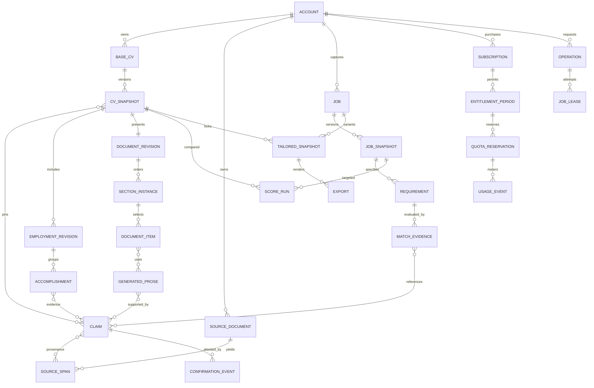

# Data model and ERD v1

Design only. All user-owned rows carry `tenant_id` (personal account/workspace), composite foreign keys include it, and ownership is never inferred from an untrusted request body. UUIDs proposed for production; human-readable IDs in synthetic fixtures. `created_at` is UTC; dates of employment retain stated precision.

## Provenance boundary

A claim is immutable factual content with a status and source evidence. Editing a confirmed fact creates a replacement claim and confirmation event; it never rewrites the claim used by an older snapshot. `user_confirmed` means attested by that person, not third-party verified. `externally_verified` additionally records method, actor, date and source. Extraction confidence is parser metadata, not truth probability. Suggested and rejected claims cannot support approved generated text or score coverage. Provenance locators reference original page/span or interview question/answer; a generated summary is never its own source evidence.

A fact entity (role, skill, education entry) has a stable identity. Snapshot associations pin immutable entity revisions and claim IDs. Each version includes a complete canonical JSON projection for portability/reproduction plus normalized rows for ownership, querying and relational constraints. Both are written atomically; canonical JSON is derived from the same revision data, not an independently edited second truth. Content hashes exclude volatile audit fields. Store JSON snapshots compactly with a retention budget; do not duplicate whole source PDFs per version.

## Normalized entities

| Table/group | Key relationships and purpose |
|---|---|
| account, user_profile, membership | Auth subject→personal account; UI locale, consent preferences; account has members/roles for future teams without enabling teams in MVP |
| source_document | Owner, private object key, MIME/hash/size, capture type, extraction state, retain_until; no public URL |
| extraction_run, source_span | source→extractor/version/page/span/text confidence; original text stays untrusted; redaction/normalization version |
| claim, claim_provenance, claim_relation | Immutable typed text/date/location/metric, status; many source spans; metric_of/supports/contribution_to/scope_of relations |
| confirmation_event | Claim, actor, attestation/verification method, accepted/rejected/revoked, source version/time; append-only except privacy deletion |
| base_cv, cv_snapshot | Account→Base head; snapshot sequence,parent,canonical schema version/hash/as-of; head changed with optimistic compare-and-swap |
| identity_revision, positioning_title | Name claim; title slot1/2 independent; no reuse as historical role title unless explicitly factual |
| contact_revision | Kind,email/phone/location/address/link claim,visibility; optional address; selected export contacts separately pinned |
| skill_revision, skill_evidence | Professional/technical class, concept ID, label claim; context evidence/responsibility links; duplicate concepts do not multiply score |
| employment_revision | Role ID,snapshot,title/company/location/start/end claims,ongoing; multiple concurrent roles valid |
| role_responsibility, accomplishment, accomplishment_evidence | Role→scope/action/result claims; metric/evidence many-to-many, selected prose separately; dates/metrics never invented |
| enrichment_attribute | Target role/project/etc, attribute kind systems/technology/contribution/time/cost/accuracy/revenue/productivity/scale/stakeholders/budget/team/project, claim references |
| education_revision | Institution,qualification,field/location/dates,distinctions/coursework claims |
| optional_section_entry | Typed certification/project/achievement/portfolio/language/leadership/publication/volunteering/custom entries; label/detail/date/link/metric claims; language proficiency is a claim, not inferred from UI locale |
| interview, interview_turn, answer_claim | Question/purpose/target context and source Base version, raw answer source, extracted claims, confirmation/skip/unknown; conversational wording separate from facts |
| generated_prose, generation_run | Kind/locale/text,supporting claims,approval,provider/model resolved,prompt/rules/input hash; result is proposed until accepted |
| document_revision, section_instance, document_item | CV snapshot→template version,ordered section IDs; section label/kind/visibility; ordered roles/accomplishments/prose/skill IDs; adding or hiding section never deletes career facts |
| job, job_capture, job_snapshot | Canonical URL/hash/source/consent, sanitized extracted text, user reviewed version/company/title/location; job edits create new immutable snapshot |
| requirement, requirement_atom, keyword_occurrence | Job snapshot→category/required-preferred/evidence spans/concept/importance; OR-group alternatives, AND atoms with allocated weights; keywords do not double count atoms |
| concept_alias_version, match_evidence | Dictionary revision/language/context/exclusions; requirement→claim→document item,exact/equivalent/partial/ambiguous/rejected relation and human review |
| score_rules_version, score_run, score_component | Snapshot+job+dictionary+normalizer+rules+as-of hashes; deterministic contributions, lower/upper envelope, required gap list, explanations; provenance persisted |
| recommendation | Type/priority,job requirement evidence,available confirmed claims,missing question,proposed section/patch,estimated change bound; never creates an empty scoring bonus |
| tailored_cv, tailored_snapshot, change_proposal | Per-job branch pins Base/job versions; changed prose/selection/order; patch-level approval and immutable acceptances; no silent Base write |
| template, template_version | Reviewed print source,section capabilities,font/renderer dependencies and layout constraints; global read-only assets vs private user content |
| export, export_check | Exact document/template/language/privacy hash; operation/object checksum/TTL and PDF extraction report/renderer version; re-export identical bytes can use private cache |
| subscription, provider_event | Stripe customer/subscription/price IDs,term,state,renewal times; signature-verified event ID unique; no PAN/card data stored |
| entitlement_revision, entitlement_period | Effective feature rules under the [accepted billing direction](../../docs/product/prd.md#10-account-subscriptions-entitlements-and-privacy); current provider state reconciliation |
| quota_reservation, usage_event, usage_aggregate | Operation and period unique reservations; every provider attempt/token/cache/output/price version/cost state; settled/released/refunded with idempotent transitions |
| operation, job_lease, outbox | Durable async state,phase,attempt,lease owner/expiry,idempotency key,deadline,cancellation fence; commit effects+outbox in same transaction |
| audit_event, consent_record, deletion_request | Actor/action/resource IDs/safe deltas; policy/provider disclosure version/time/scope; resumable rights workflow with tombstone/backup expiry |

Add uniqueness `(tenant_id, idempotency_key, operation_kind)`; `(provider,event_id)`; `(tenant_id, canonical_job_hash)`; `(tenant_id,score_input_hash)`; `(tenant_id,quota_period,operation_id,meter)`; section/item ordinal unique within parent; selected contact FK requires same owner and permitted visibility. Every Base/tailored snapshot reference must belong to same tenant. Read-only templates/dictionaries are global without user PII. Admin support grants are separate audited, expiring privileges.

## ERD

## Canonical contract

[Schema v1](../../schemas/cv/v1/schema.json) is a CV snapshot, not a schema for billing/users/jobs. Cross-domain IDs live in `context`; actual entity contracts above and API below handle those domains. Arrays may be empty for partial/onboarding records. Exactly two positioning title slots may independently be null. `document.sectionOrder` contains every section instance once; data array order is not display order. A section's entries and prose list supply selection/order. All baseline section kinds exist, with custom evidenced content allowed.

[Validation](../../schemas/cv/v1/validate.py) enforces JSON structure and reference/status/privacy/date invariants; JSON Schema alone cannot resolve cross-record references or establish truth. The discovery `export_projection` demonstrates private contacts and pending prose exclusion, not a full renderer or injection-proof export implementation. Confirmed facts can remain omitted from document while retained in Base. A separate export service must validate every selected field/item and locale before rendering.

Schema migration uses major paths v1/v2; additive optional changes bump minor but keep pinned validator. Never mutate published snapshots in place. Backfill new projections alongside old, verify hashes/references, then switch readers. Preserve old rules/templates/fonts while reproducibility retention permits; deletion rights override indefinite historical retention.

## Assessment1.1 additions after review round1

Score_run stores candidateFit andcvMatch separately with profileAvailable/null semantics,identifiedhard-gate eligibility assertions/status,independentreadabilitystatus,requirement/evidence/rule/weight-profile hashes andeffectiveweights. Eachcanonicalrequirement hasoneprimarycategory;ORalternatives/ANDfractions/polarity are explicit. Match_evidence records1/.75/.4/0class,acceptedrelation,profileclaimandCVitemreferences,explanation andper-requirementpointcontribution. Confirmed-unmetgateassertions retainactor/source/reason;absencecannotproduceconfirmedgap. Candidatecomparisonreusesprofilemapping andneverrisesfromCV-onlywording. CanonicalCVschema1.0unchanged;companionassessment-input1.1separate.
