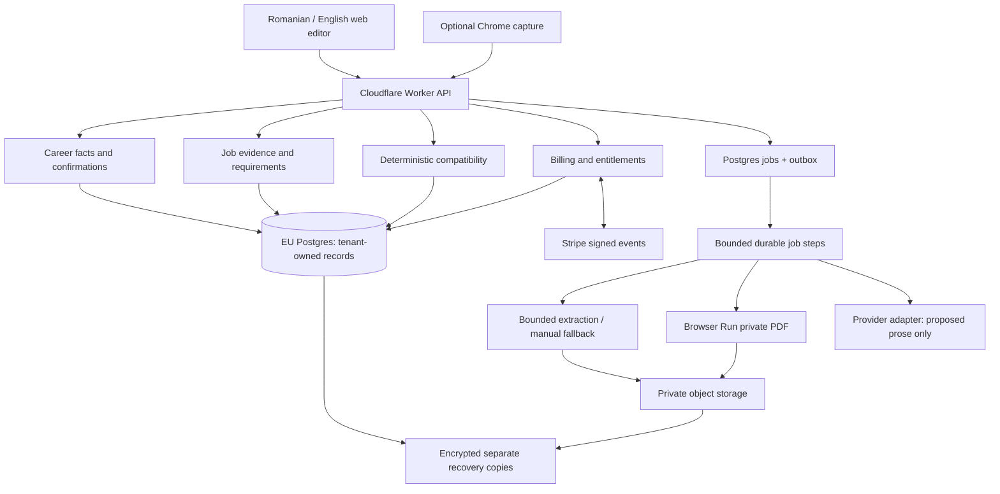

# Technical architecture proposal v2 — 2026-10-23

**Discovery proposal, no production build. Cross-review and approval pending.** The authoritative baseline is product-brief.md dated2026-10-23. Source IDs resolve in [sources](sources.md). All capacity, quality and adoption estimates are hypotheses.

## Recommendation and alternatives

**Recorded owner preference from review round1: A, Supabase + Cloudflare Worker API/static assets + Browser Run.** Target Supabase Free and Browser Run's free zone for an initial constrained pilot; OpenAI inference is initially paid. No provisioning or production approval has been granted. The EU Node optionC remains an explicit fallback if runtime/private-processing constraints cannot be satisfied, not an automatically deployed service.

Use one TypeScript domain codebase with logical modules, tenant-protected Postgres operations/leases/outbox, a thin Worker API and remote Browser Run PDF boundary. Requirements/evidence are proposed through the OpenAI adapter; deterministic replay calculates Candidate Fit and CV Match separately. Templates and source confirmation remain independent. No Redis/vector database or workflow SaaS is required initially.

Free feasibility must be proven rather than assumed. Supabase Free has500MBDB/1GBfiles/5GBuncachedegress/50kMAU,max2projects and inactivity pause. Browser Run Free is600seconds/day with3concurrent sessions; no monthly quota pooling. Workers Free has10msCPU/request and128MBisolate; the existing paid-scale CPU assumption50ms exceeds it. At10MBfiles/user,100users already fill the file allowance. A25-user resource scenario fits average storage/rendering limits but **free runtime remains unproven** until bounded API/parser measurements. Pause/queue/manual fallback before quotas; no unapproved paid-tier upgrade. Backups, AI and other unknown costs are retained.

C preserves ordinary isolated Node/PDF/OCR processes if a later approved fallback is needed; free Workers cannot be promised full native parser/OCR behavior. Keep manual/paste recovery and bounded extraction review. Private-data residency/DPAs remain separate from choosing an EU database or a free plan.

| Option | Concrete stack | Strength | Cost/operational cost | Decision |
|---|---|---|---|---|
| A | Supabase + Cloudflare Worker API/static + Browser Run | Small ops surface; cheap elastic rendering | Worker parser limits; remote rendering adds PII subprocessor; global processing not automatically EU | Owner-preferred discovery path; constrained free-pilot feasibility and privacy checks required |
| B | One EU Node host + Postgres + mature auth/session library + local private files/S3-compatible backup | Few paid dependencies; portable and low server invoice | Own security patches, auth abuse controls, DB restores, disk growth and availability; one host outage affects all | Credible lower-invoice alternative for an operator willing to own DB/auth; not recommended for minimal small-business ops |
| C | EU Node app/worker + Supabase DB/Auth/private Storage + local Chromium | Familiar libraries, managed data services, EU document runtime; one domain codebase | One host to patch; managed DB plus host cost; queue backup still needed | Fallback only if approved after runtime/residency proof; paid scale reference includes host |
| D | Django/Laravel monolith + Postgres on same EU host | Mature auth/forms/jobs; strong choice with existing team skills | Two languages if frontend/extension TypeScript; schema type generation boundary | Prefer over TypeScript if team expertise warrants; not inherently less secure/expensive |
| E | Firebase/Firestore or Cloudflare D1 + separate identity | Fast integrated start | Relational provenance/version joins and tenant controls become more complex; migration/cross-provider auth work | Do not adopt without measurable benefit over Postgres |

Supabase versus plain Postgres: same relational domain; Supabase Auth/Storage save implementation effort, but RLS/service-role and backup limitations need explicit testing [E-12/13]. Plain Postgres with pg-boss-like lease pattern avoids queue SaaS; Redis/BullMQ becomes justified only if measured queue throughput/latency outgrows DB job leases. No realtime subscription is necessary for autosave; poll own operation with backoff or SSE if useful.

Stripe versus Paddle: Stripe Romania published standard EEA1.5%+RON1 plus Billing0.7%; seller owns tax/legal/accounting. Paddle public5%+50c includes Merchant of Record responsibilities [E-05/11]. Different contract/tax liability matters more than comparing percentages alone. Do not calculate a plan margin until selling price, tax-inclusive treatment, paid conversion and payment mix are approved.

TypeScript vs Python: TS shares schema-derived types across browser, API and extension, keeps the small team on one language, and supports Node extraction/rendering libraries [E-23]. Python is attractive for future NLP/OCR, but a second production service is unnecessary for deterministic matching and dictionary lookup. Discovery validators use Python only because it is already available; these scripts are not production scaffolding.

## Module ownership and dependency rules

1. Identity/access validates sessions, tenant membership, CSRF and extension scopes. Accounts include a personal workspace initially; owner_id is a boundary even if teams are deferred.
2. Career domain owns claims, provenance, confirmation events, Base snapshots and interview answers. Only explicit user commands can confirm or revise claims. User-confirmed is not independently verified.
3. Job domain owns captured text/link, immutable job snapshots, requirement atoms, keyword concepts and evidence spans. It cannot alter career data.
4. Compatibility owns normalization dictionary, evidence links, versioned deterministic rules, explanations and section recommendations. It reads version IDs; it cannot invent facts or grant plan access.
5. Generation prepares a bounded prompt from selected confirmed claims and job evidence. It returns a proposed content patch with claim references, never executable instructions or direct DB writes.
6. Document owns ordering, selected entries/prose, localization, template versions, renderer manifest and immutable exports. Templates are code-reviewed assets with no runtime user scripts.
7. Billing owns verified event ingest, subscription mirror, entitlement revision and quota reservation/settlement. Client controls cannot override it.
8. Platform owns operation/job leases, idempotency, usage ledger, cache, audit/redaction and deletion workflow. Modules call typed application services; they do not update another module's tables directly.

One repository, one domain package, one thin Worker API and bounded logical job steps from the same release. PreferredA uses bounded Worker-compatible extraction and a separate Browser Run processing boundary; it cannot launch native OS parser children. OptionC can isolate native parser/renderer processes if separately approved. Limits and manual fallback are explicit. No vector database, agent orchestration framework, bespoke workflow SaaS or commercial ATS API is needed for v1.

## Architecture diagram

## Library decisions

| Concern | First candidate | Alternative / exit criterion |
|---|---|---|
| PDF text | PDF.js text items, deterministic page/position locators | Poppler pdftotext independent oracle; scan-only PDF needs local OCR or manual fallback |
| DOCX text | Mammoth raw text, ZIP/XML constraints | Direct OOXML text extraction or LibreOffice sandbox; never inject Mammoth HTML [E-18] |
| OCR | Optional local Tesseract process | Manual entry initially; hosted document AI only after quality/privacy/cost comparison; no inference experiment authorized |
| Schema | JSON Schema2020-12 + Ajv runtime, generated TS types | Zod as frontend convenience, schema remains canonical; preserve migration fixtures [E-18] |
| API validation | Shared JSON Schema boundaries; small router/Hono/Fastify choice after team benchmark | Framework-free Node possible but sessions/error handling need discipline |
| SQL | SQL migrations + thin typed query builder | Prisma/Drizzle optional; avoid hiding ownership predicates or transactional invariants |
| PDF export | Reviewed HTML/CSS print template + pinned Browser Run-compatible rendering; Node Chromium fallback only if approved | Puppeteer equivalent; PDF-lib for exact primitives but more layout code; React-PDF page failed research fetch so not verified [E-19] |
| Queue | DB lease/outbox with SKIP LOCKED and idempotent effects | Cloudflare Queues only if measured need and approved quota/cost; Postgres-backed jobs remain first candidate; Redis only if measured operational need |
| AI | Small provider adapter, structured result validation | No LangChain dependency needed; local open-weight model only after measured quality and operator-cost evaluation |

Pin versions, review transitive licenses/SBOM and supply-chain risk during implementation. No install, hosting account or SaaS was purchased here.

## Feasibility and simplification feedback for Firstmate

Paste/manual job input, deterministic recalc, section/bullet rewrites and one tested single-column template create the cheapest complete useful slice. Preserve two titles, all schema section kinds, privacy controls, version history and confirmation states from day one. Defer extension and broad website scraping until paste/capture demand is observed. Multiple visual templates require separate PDF reading-order regression fixtures. A heavy automatic regenerate-on-edit flow increases cost, latency and claim risk with little benefit; show a bounded regeneration action and its scope instead. Interface language and CV language are independent configuration, never one inferred from the other.
